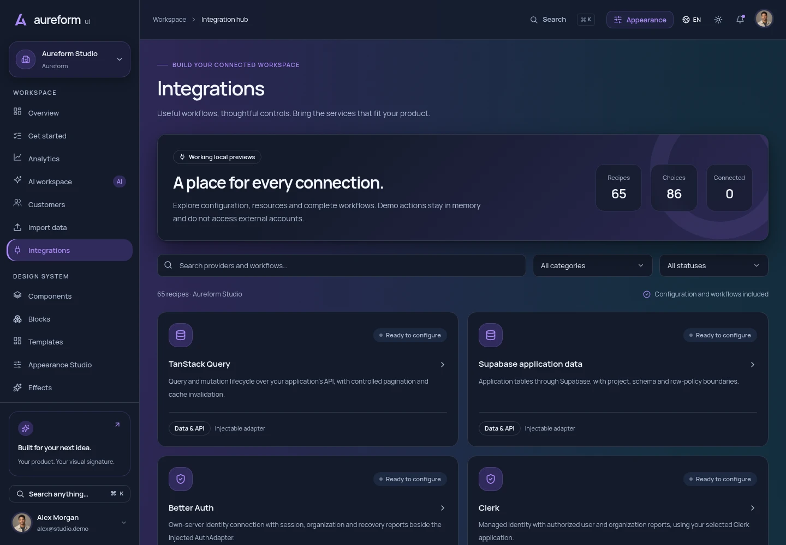
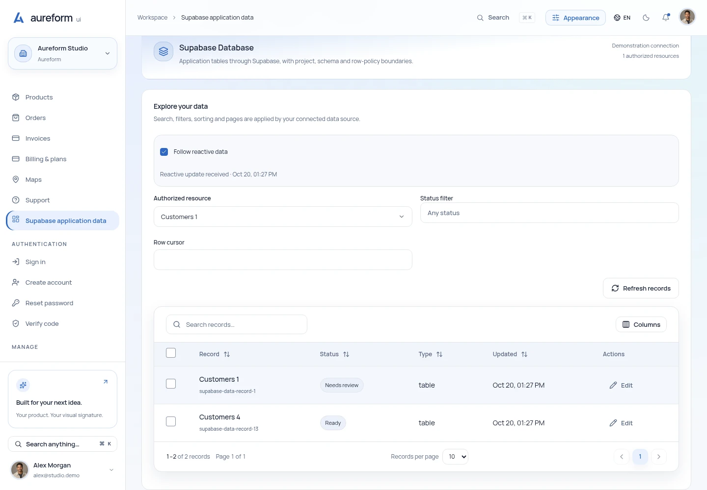
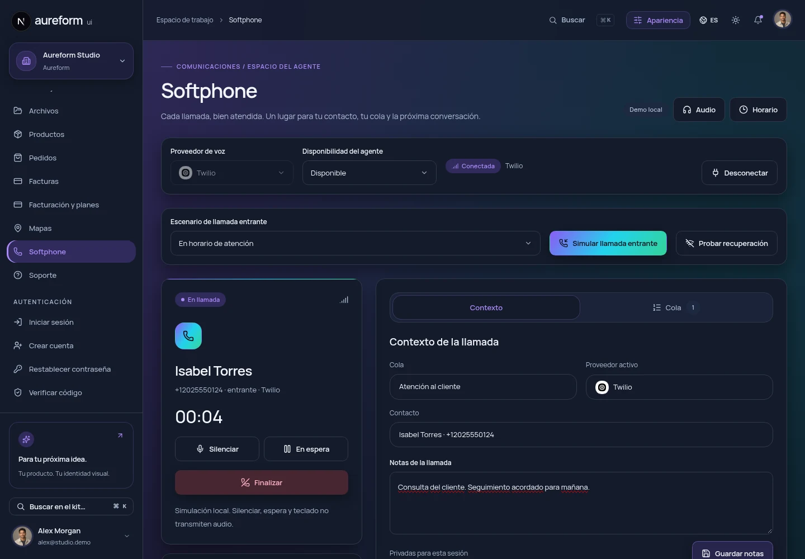
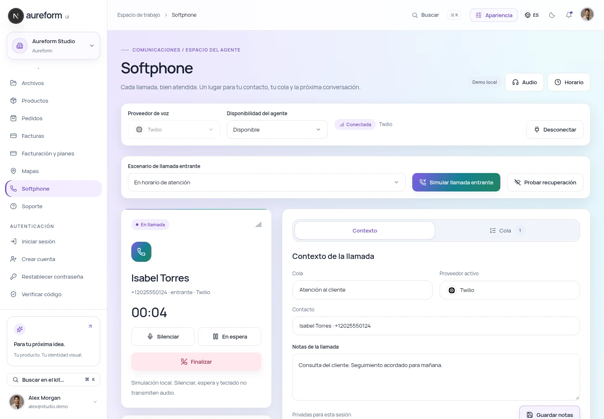

# Aureform UI

[](https://github.com/terrizoaguimor/aureform-ui/releases/latest) [](LICENSE) [](https://github.com/terrizoaguimor/aureform-ui/actions/workflows/cloudflare.yml) [](https://github.com/terrizoaguimor/aureform-ui/actions/workflows/pages.yml)

**Interfaces con personalidad. Código editable. Abierto para todos.**

Un UI kit de Next.js para dashboards, espacios SaaS y herramientas internas, con 65 recetas de integración, un estudio de apariencia y una biblioteca editable de Figma.

[**Explorar la demo ↗**](https://aureformui.com/es/) · [**Documentación**](https://aureformui.com/es/docs/) · [Changelog](CHANGELOG.es.md) · [Calidad y Lighthouse](https://aureformui.com/es/quality/) · [Figma](https://www.figma.com/design/lHp5p10yGb7lqXJDnAox0N) · [Patrocinar](https://github.com/sponsors/terrizoaguimor) · [Empezar](#empezar) · [Contribuir](CONTRIBUTING.md) · [English](README.md)

[](https://aureformui.com/es/) [](https://aureformui.com/es/docs/) [](https://www.figma.com/design/lHp5p10yGb7lqXJDnAox0N) [](https://aureformui.com/r/registry.json)

[](https://aureformui.com/es/changelog/)


**70 vistas principales + 65 recetas de integración + un hub · 44 familias de componentes · 140 entradas de registry · 6 paletas · English / Español · Claro / Oscuro**

Construido con **Next.js 16, React 19, TypeScript, Tailwind CSS 4, Base UI, GSAP y Lenis**. El código original de Aureform está disponible bajo [Apache 2.0](LICENSE).

[](package.json) [](package.json) [](package.json) [](package.json) [](package.json) [](#empezar) [](package.json) [](https://aureformui.com/es/docs/) [](https://aureformui.com/es/docs/tokens/)

## Qué incluye

[](https://aureformui.com/es/docs/data-table/) [](https://aureformui.com/es/docs/charts/) [](https://aureformui.com/es/forms/) [](package.json) [](https://aureformui.com/es/docs/maps/)

| Incluido                                | Qué puedes construir                                                                                                                                                                           |
| --------------------------------------- | ---------------------------------------------------------------------------------------------------------------------------------------------------------------------------------------------- |
| **68 vistas de la suite + una landing** | Dashboards, CRM, comercio, onboarding, operaciones de clientes, ajustes de equipo, correo, chat, tareas e interfaces de trabajo con IA.                                                        |
| **Componentes, bloques y plantillas**   | Botones, formularios, diálogos, tablas, navegación, gráficos y flujos compuestos. Copia el código que necesites mediante la CLI local o el registry de shadcn.                                 |
| **Un estudio de apariencia**            | Aurora, Violet, Ocean, Mint, Ember y Rose; colores, shades, gradientes, materiales, tipografía, radio, densidad y estados hover. Guarda presets y exporta JSON, CSS o React.                   |
| **Seis efectos reutilizables**          | Fondo con gradientes, fondo con shaders, spotlight, borde con brillo, tarjeta con inclinación y botón magnético, con soporte para movimiento reducido y una alternativa estática para shaders. |
| **Diseño e imágenes**                   | Biblioteca nativa de Figma, tokens compartidos, fuentes locales y 32 imágenes originales generadas con GPT Image 2.5: retratos, avatares de organizaciones, productos y escenas editoriales.   |

| Modo claro                                                                     | Estudio de apariencia                                                                            |
| ------------------------------------------------------------------------------ | ------------------------------------------------------------------------------------------------ |
|  |   |
| **Gráficos**                                                                   | **Biblioteca de componentes**                                                                    |
|            |  |

## Integraciones listas para conectar en 1.5

[](https://aureformui.com/es/integrations/) [](docs/integrations/provider-coverage.json) [](https://aureformui.com/es/docs/integrations/) [](docs/integrations/ai.md)

Abre el [centro de integraciones](https://aureformui.com/es/integrations/) y prueba [Supabase](https://aureformui.com/es/integrations/supabase-data/), [Clerk](https://aureformui.com/es/integrations/clerk/), [Stripe](https://aureformui.com/es/integrations/stripe/), [OpenAI](https://aureformui.com/es/integrations/openai-responses/), [Resend](https://aureformui.com/es/integrations/resend-react-email/) o [Cloudflare Agents](https://aureformui.com/es/integrations/cloudflare-agents/).

Incluye tablas controladas, flujos completos de identidad, comercio, archivos, correo, analítica, notificaciones, tareas, colaboración, editores, búsqueda, mapas, AI, conocimiento, agentes, conectores de producto y automatización. Cada receta ofrece flujos locales funcionales, estados de conexión, permisos lógicos, selección de recursos, actividad, revisión y solicitudes recuperables.

| Centro de integraciones · oscuro | Flujo de datos conectados · claro |
| --- | --- |
|  |  |

Inyecta `IntegrationSuite` o un adaptador tipado para conectar tu aplicación. Las fábricas HTTP cubren el hub y los transportes de identidad, AI y comercio; los callbacks de edición y tiempo real permiten usar tu SDK. Tu aplicación aporta cuentas, credenciales, autenticación, autorización del servidor y conectividad con los proveedores. La demo pública no realiza acciones en cuentas externas.

```sh
node bin/aureform.mjs add integration-hub integrations-suite --cwd ../mi-producto
```

[Guía de conexión →](https://aureformui.com/es/docs/integrations/) · [Cobertura de proveedores →](docs/integrations/provider-coverage.json) · [Alcance de la versión 1.5 →](docs/release-checklist-1.5.0.md)

## Softphone y comunicaciones

[](https://aureformui.com/es/softphone/) [](docs/communications/IMPLEMENTATION-STATUS.md)

[](docs/communications/AUTOMATIC-SETUP.md) [](licenses/third-party/twilio-voice-sdk.txt) [](licenses/third-party/telnyx-webrtc.txt)

[Abrir el softphone →](https://aureformui.com/es/softphone/) · [Guía de conexión →](https://aureformui.com/es/docs/communications/) · [Implementación y evidencia →](docs/communications/IMPLEMENTATION-STATUS.md)

| Workspace oscuro | Workspace claro |
| --- | --- |
|  |  |

El espacio de llamadas entrantes incluye presencia, cola FIFO, horario y fechas explícitas de festivos, contestar/rechazar, silenciar, espera, DTMF, notas, historial, exportación CSV y recuperación de conexión. La demo local funciona sin credenciales ni cargos telefónicos. Las pruebas de micrófono y altavoz comienzan únicamente cuando se solicitan.

La [referencia de autoconfiguración](docs/communications/AUTOMATIC-SETUP.md) pide únicamente Account SID + Auth Token para Twilio, o API Key + Public Key para Telnyx. Un backend autenticado descubre los números existentes, prepara un plan para revisar, genera los recursos internos y verifica el enrutamiento. Las credenciales y los registros de las operaciones se guardan cifrados en el host. Conectar el navegador y autorizar una llamada limitada son pasos separados.

El [recibo de validación](docs/communications/AUTOMATIC-SETUP-VALIDATION.md) separa pruebas de demo pública, autenticación privada, tipos SDK instalados y fuente editable en Figma de la aceptación con carriers reales. Para la primera prueba Twilio, usa una cuenta Full activa, su Auth Token principal y un número de voz existente en US1; todavía no se certifica una llamada real.

La demo estática usa credenciales ficticias de solo lectura y no contacta a un carrier. La referencia privada incluye los SDKs oficiales; cada consumidor puede reemplazar el host, la autenticación y los adaptadores. Las llamadas audibles reales y la compatibilidad de producción requieren aceptación independiente por proveedor.

```sh
node bin/aureform.mjs add softphone-workspace --cwd ../mi-producto
# Cliente real y conexión opcional de proveedor:
node bin/aureform.mjs add communications-live twilio-browser-voice --cwd ../mi-producto
# Autoconfiguración y host del softphone conectado:
node bin/aureform.mjs add communications-setup connected-softphone --cwd ../mi-producto
```

El [paquete de investigación de Communications](docs/communications/RESEARCH.md) conserva la [arquitectura](docs/communications/ARCHITECTURE-RFC.md), [matriz de capacidades](docs/communications/CAPABILITY-MATRIX.md), [controles de seguridad](docs/communications/SECURITY-COMPLIANCE.md) y [roadmap por fases](docs/communications/ROADMAP.md). Compra y portabilidad de números, mensajería omnicanal, voz con IA y Prompt-to-Flow corresponden a etapas posteriores. El [registro de fuentes Figma](design/reports/communications-2026-10-21.md) conserva el research original y la recuperación anterior; la [autoconfiguración](design/figma/communications-setup-native-source-2026-10-21.json) tiene su propio suplemento de fuente nativa.

## Comercio, mapas y autenticación

[](https://aureformui.com/es/docs/adapters/) [](https://aureformui.com/es/docs/maps/) [](https://aureformui.com/es/docs/authentication/)

Explora [Productos](https://aureformui.com/es/products/), [Pedidos](https://aureformui.com/es/orders/), [Facturas](https://aureformui.com/es/invoices/), [Facturación](https://aureformui.com/es/settings/billing/) y [Mapas](https://aureformui.com/es/maps/).

El editor de productos incluye vista previa y galería con carga, recorte, rotación, texto alternativo, imagen principal y orden. Los precios del catálogo alimentan los pedidos; un pago mock exitoso actualiza existencias y genera una factura. Facturación ofrece planes, historial y vista previa del portal. El adaptador tipado de Stripe conecta estas pantallas con **tu backend autenticado**.

Mapas funciona con geometría local y admite Google Maps mediante una clave de navegador restringida. [Login](https://aureformui.com/es/auth/sign-in/) y [registro](https://aureformui.com/es/auth/sign-up/) muestran **botones mock de Google, GitHub y Microsoft**, con callbacks para tu proveedor. También están disponibles recuperación y verificación. La demo pública no realiza OAuth ni cobros reales.

| Catálogo de productos                                                                                    | Acceso social                                                                               |
| -------------------------------------------------------------------------------------------------------- | ------------------------------------------------------------------------------------------- |
|  |      |
| **Facturación y planes**                                                                                 | **Workspace de mapas**                                                                      |
|           |  |

| Editor de imágenes de productos                                                                               | Pedidos y checkout                                                                                  |
| ------------------------------------------------------------------------------------------------------------- | --------------------------------------------------------------------------------------------------- |
|  |  |

[Contratos y ejemplos de integración →](docs/application-integrations.es.md)

[Validación y alcance de la versión 1.4 →](docs/release-checklist-1.4.0.md)

## Empezar

Necesitas **Node.js 22.18.0+** y **pnpm 10**. El repositorio fija la versión de pnpm en `package.json`. Si `corepack` no está disponible, instálalo primero con `npm install --global corepack`; Node.js 25+ requiere instalarlo por separado. Consulta la [guía de Corepack](https://github.com/nodejs/corepack#default-installs).

```sh
git clone https://github.com/terrizoaguimor/aureform-ui.git
cd aureform-ui
corepack enable
pnpm install --frozen-lockfile
pnpm dev
```

Abre [localhost:3000/es/](http://localhost:3000/es/) o [localhost:3000/en/](http://localhost:3000/en/). Las imágenes y fuentes incluidas son archivos locales; **ejecutar la suite no requiere claves API**.

Para construir y previsualizar la exportación estática:

```sh
pnpm build
pnpm start
```

El resultado queda en `out/`. GitHub Pages usa el prefijo del proyecto durante el build:

```sh
NEXT_PUBLIC_BASE_PATH=/aureform-ui pnpm build
```

La [guía de GitHub Pages](docs/github-pages.md) explica el despliegue y la [guía de código abierto](docs/open-source.es.md) cubre la integración.

## Usarlo en tu proyecto

**Crear una aplicación inicial.** Ejecuta la CLI local desde este checkout:

```sh
node bin/aureform.mjs list
node bin/aureform.mjs init ../mi-producto --no-install
pnpm --dir ../mi-producto install
pnpm --dir ../mi-producto dev
```

**Añadir código seleccionado.** Revisa la propuesta antes de aplicarla:

```sh
node bin/aureform.mjs add data-workbench import-wizard customer-detail \
  --cwd ../mi-producto --dry-run
node bin/aureform.mjs add data-workbench import-wizard customer-detail \
  --cwd ../mi-producto
pnpm --dir ../mi-producto install
```

La CLI copia dependencias y los activos usados, respeta los aliases configurados y protege el código existente. `--diff` muestra los cambios propuestos sin escribir archivos. [Guía de la CLI →](docs/cli-updates-1.2.md)

**Usar el registry de shadcn.** Desde un proyecto Next.js / Tailwind 4 con shadcn configurado:

```sh
pnpm dlx shadcn@4.22.0 add \
  https://aureformui.com/r/button.json
```

Explora el [registry de 140 entradas](https://aureformui.com/r/registry.json). Algunos componentes y bloques requieren los estilos incluidos y los providers de idioma o apariencia; consulta sus ejemplos antes de integrarlos. [Guía del registry →](docs/registry-compatibility.md)

## Un frontend que puedes conectar

La demo incluye flujos interactivos de filtros, vistas guardadas, importación CSV, onboarding, miembros y detalle de cliente. Los registros y las preferencias se guardan **en tu navegador**.

La autenticación real, autorización del servidor, bases de datos compartidas, envío de correo, facturación y llamadas a modelos de IA son integraciones que debes aportar. La vista previa de roles simula permisos; no protege un backend. Los adjuntos del detalle de cliente guardan metadatos; el gestor de archivos usa almacenamiento local del navegador.

Los bloques de operaciones reciben datos y callbacks para conectar tus servicios. Empieza por los [contratos SaaS](docs/saas-operations.es.md), la [arquitectura](docs/architecture.md) y los [ejemplos de componentes](examples/README.md).

<a id="figma-source-and-packages"></a>

## Diseño, movimiento e imágenes

[](docs/motion-runtime.md) [](docs/motion-runtime.md) [](docs/generated-images/README.es.md)

- **Figma:** [biblioteca editable](https://www.figma.com/design/lHp5p10yGb7lqXJDnAox0N) y [archivos de diseño / notas de exportación](design/README.md). Consulta esas notas para conocer los archivos disponibles y sus formatos reales.
- **Apariencia:** [configuración y exportaciones](docs/appearance.md), [efectos](docs/effects.es.md), [shaders](docs/shaders.md) y [gráficos](docs/charts.md).
- **Movimiento:** GSAP controla las entradas dentro de su ámbito; Lenis es opcional en la landing. Las pantallas de aplicación mantienen el scroll nativo. [Contrato de runtime](docs/motion-runtime.md).
- **Imágenes:** [colección de 32 imágenes](docs/generated-images/README.es.md), [prompts completos](docs/generated-images/catalog.json), [WebP originales](design/images/masters/) y [manifest de activos](public/assets/generated-images.json). Se incluyen WebP optimizados; sus archivos SVG incorporan los mismos píxeles para transportarlos mediante el registry de texto.

Los registros de packaging y QA conservan su versión y alcance originales. La [guía de código abierto](docs/open-source.es.md#verificar-cambios-y-contribuir) explica cómo interpretarlos.

## Documentación y despliegue

[](docs/cloudflare-deployment.es.md) [](docs/release-checklist-1.4.1.md) [](https://aureformui.com/es/docs/research/)

[Lee la documentación](https://aureformui.com/es/docs/) sin abrir el workspace de la demo. Sus 25 capítulos cubren instalación, componentes, tokens, movimiento, charts, tablas, integraciones, comunicaciones, research de integraciones, Figma y despliegue, con búsqueda por títulos y secciones, índice de página y código copiable. La navegación está disponible en español e inglés; las referencias que conservan su idioma original lo indican en la página.


El sitio principal funciona en **Cloudflare Workers Static Assets**. La [guía de despliegue](docs/cloudflare-deployment.es.md) explica el export estático, los dominios y la redirección de descarga del código. [GitHub Pages](https://terrizoaguimor.github.io/aureform-ui/) mantiene un despliegue separado con su propio base path.

```sh
NEXT_PUBLIC_BASE_PATH="" pnpm build:cloudflare
pnpm exec cf deploy --prebuilt --dry-run
pnpm deploy:cloudflare
```

Configura `NEXT_PUBLIC_SITE_URL` con el dominio canónico de tu proyecto. Desplegar requiere acceso a tu cuenta de Cloudflare; ejecutar la demo y construirla localmente no requiere credenciales. El estado generado de despliegue se excluye de Git y de los paquetes de código.

La [investigación bilingüe de producto](docs/website/es/research.md) combina tres investigaciones headless con Gemini 4 Argon, 52 búsquedas observadas, revisión independiente de fuentes y ocho prioridades con criterios de aceptación. Sus [registros de ejecución y verificación](docs/research/2026-10-20/) separan evidencia de propuestas que necesitan validación con usuarios. El [estudio original de 20 hallazgos](docs/research-gaps-1.4.es.md) sigue disponible.

[](https://aureformui.com/es/docs/integration-research/) [](docs/research/2026-10-20/integrations/npm-downloads.json)

El [research de integraciones](docs/website/es/integration-research.md) ([English](docs/website/en/integration-research.md)) es un estudio separado de identidad, datos, comercio, AI, servicios operativos y conectores de producto. Cuatro investigaciones headless de AGY completadas registraron 99 búsquedas; el [paquete de evidencia](docs/research/2026-10-20/integrations/) incluye la muestra fechada de 70 paquetes npm, procedencia, fuentes primarias y fichas bilingües. Las descargas son señales de instalación, no usuarios únicos ni cuota de Next.js. La versión 1.5 implementa sus 65 recetas frontend. El estudio fechado conserva su base original y los requisitos del backend consumidor.

## Calidad que puedes comprobar

[](https://github.com/terrizoaguimor/aureform-ui/actions/workflows/quality.yml)

<!-- BEGIN:quality-results -->
[](https://aureformui.com/es/quality/) [](https://aureformui.com/es/quality/)

**Medición: 2026-10-20 05:47:39 UTC · Lighthouse 13.5.0 · commit [0caf7c8](https://github.com/terrizoaguimor/aureform-ui/commit/0caf7c8874ea8bb2b1580c0d59a9bda4497cbdd4).** Medianas de tres pasadas por página y dispositivo; puntajes sobre 100.

| Página · Dispositivo | Rendimiento | Accesibilidad | Buenas prácticas | SEO |
| --- | ---: | ---: | ---: | ---: |
| Landing · Móvil | 93 | 100 | 100 | 100 |
| Landing · Escritorio | 100 | 100 | 100 | 100 |
| Documentación · Móvil | 94 | 100 | 100 | 100 |
| Documentación · Escritorio | 100 | 100 | 100 | 100 |
| Dashboard demo · Móvil | 40 | 100 | 100 | 69 |
| Dashboard demo · Escritorio | 67 | 100 | 100 | 69 |

[Metodología, métricas y los 18 informes →](https://aureformui.com/es/quality/) · [JSON y HTML originales](docs/quality/lighthouse/production-39375951507-1/)
<!-- END:quality-results -->

Cada medición audita la landing, la documentación de instalación y el dashboard demo en móvil y escritorio, tres veces por combinación. Los valores publicados son medianas de mediciones de laboratorio. Los informes HTML y JSON originales están disponibles en [el repositorio](docs/quality/lighthouse/) y en el sitio. Consulta [la guía de medición](docs/quality/README.md) para reproducirlos o actualizarlos.

El dashboard demo conserva deliberadamente `noindex`; su resultado SEO refleja esa política. Las comprobaciones de accesibilidad de Lighthouse cubren las páginas auditadas y no certifican todo el kit. Las métricas de carga de laboratorio tienen un alcance distinto de Core Web Vitals de usuarios reales.

## Apoya al mantenedor

[](https://github.com/sponsors/terrizoaguimor)

Si Aureform te ayuda en tu trabajo, puedes [patrocinar al mantenedor](https://github.com/sponsors/terrizoaguimor) mediante su perfil personal actual de GitHub Sponsors. El apoyo es voluntario; el código, los recursos originales y la documentación siguen abiertos bajo Apache 2.0.

## Contribuir

Ayuda a que otras personas encuentren y evalúen el kit en comunidades relevantes
de GitHub. La [investigación de difusión y destinos adecuados](docs/github-discovery.es.md)
incluye listas de frontend mantenidas, directorios de registros y borradores
específicos. Los topics y la descripción About identifican el stack y alcance
reales del repositorio.

[](CONTRIBUTING.md) [](https://github.com/terrizoaguimor/aureform-ui/stargazers) [](https://github.com/terrizoaguimor/aureform-ui/forks) [](https://github.com/terrizoaguimor/aureform-ui/issues)

Son bienvenidos los reportes de errores, mejoras de interacción, nuevos patrones, traducciones y documentación. Puedes contribuir en español o inglés.

Evidencia de validación de **v1.5.0**:

[](docs/qa-runtime-1.5.0.json) [](docs/qa-runtime-1.5.0.json) [](docs/qa-runtime-1.5.0.json) [](docs/integrations/provider-action-validation.json) [](docs/integrations/optional-binding-validation.json)

[](docs/qa-runtime-1.5.0.json)

Las comprobaciones usan adaptadores frontend locales y fixtures acotados del consumidor. El [recibo QA 1.5](docs/qa-runtime-1.5.0.json) registra cada tanda de navegador, los fallos iniciales del harness y sus ejecuciones dirigidas. La [QA anterior](https://github.com/terrizoaguimor/aureform-ui/blob/v1.4.1/docs/qa-runtime-1.4.1.json), los checkpoints de Figma y los informes de Lighthouse conservan su alcance original.

```sh
pnpm typecheck
pnpm lint
pnpm test
pnpm verify:examples
pnpm verify:integrations
pnpm build
```

Lee [CONTRIBUTING](CONTRIBUTING.md) para las pruebas de navegador y convenciones de diseño, el [Código de Conducta](CODE_OF_CONDUCT.md) para las normas de la comunidad y [SECURITY](SECURITY.md) para reportar vulnerabilidades de forma privada.

## Licencia y créditos

El código, la documentación y los activos originales de Aureform se publican bajo [Apache License 2.0](LICENSE). Consulta [NOTICE](NOTICE) y [THIRD_PARTY_NOTICES](THIRD_PARTY_NOTICES.md) para las atribuciones y licencias de terceros.

Creado por [terrizoaguimor](https://github.com/terrizoaguimor). Construye algo útil, adáptalo a tu proyecto y comparte tus mejoras con la comunidad.
