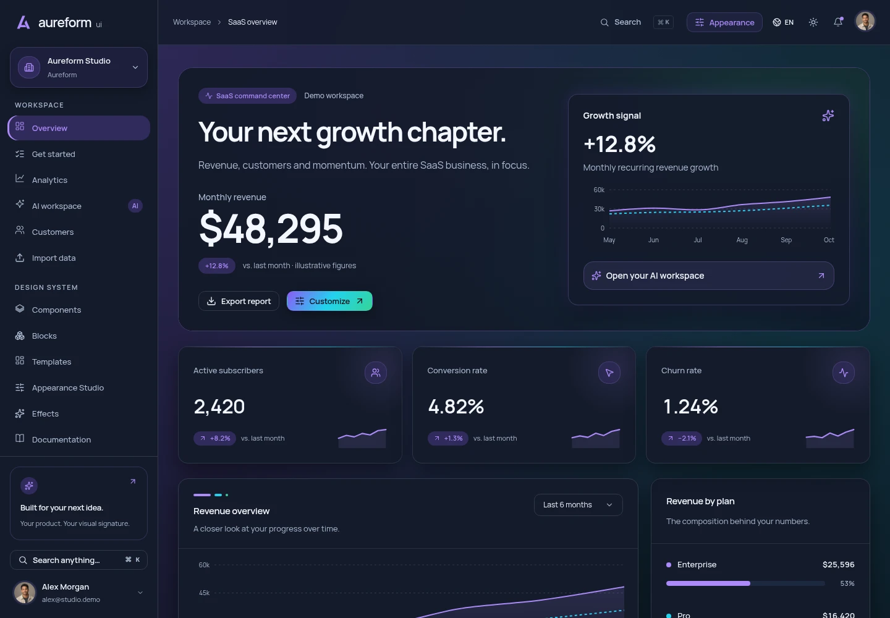

# Aureform UI

**Interfaces con personalidad. Código editable. Abierto para todos.**

Un UI kit de Next.js para dashboards, espacios SaaS y herramientas internas, con un estudio de apariencia y una biblioteca editable de Figma.

[**Explorar la demo ↗**](https://terrizoaguimor.github.io/aureform-ui/) · [Figma](https://www.figma.com/design/lHp5p10yGb7lqXJDnAox0N) · [Empezar](#empezar) · [Contribuir](CONTRIBUTING.md) · [English](README.md)



**69 vistas · 44 familias de componentes · 107 entradas de registry · 6 paletas · 13 tipos de gráficos · English / Español · Claro / Oscuro**

Construido con **Next.js 16, React 19, TypeScript, Tailwind CSS 4, Base UI, GSAP y Lenis**. El código original de Aureform está disponible bajo [Apache 2.0](LICENSE).

## Qué incluye

| Incluido                                | Qué puedes construir                                                                                                                                                                           |
| --------------------------------------- | ---------------------------------------------------------------------------------------------------------------------------------------------------------------------------------------------- |
| **68 vistas de la suite + una landing** | Dashboards, CRM, comercio, onboarding, operaciones de clientes, ajustes de equipo, correo, chat, tareas e interfaces de trabajo con IA.                                                        |
| **Componentes, bloques y plantillas**   | Botones, formularios, diálogos, tablas, navegación, gráficos y flujos compuestos. Copia el código que necesites mediante la CLI local o el registry de shadcn.                                 |
| **Un estudio de apariencia**            | Aurora, Violet, Ocean, Mint, Ember y Rose; colores, shades, gradientes, materiales, tipografía, radio, densidad y estados hover. Guarda presets y exporta JSON, CSS o React.                   |
| **Seis efectos reutilizables**          | Fondo con gradientes, fondo con shaders, spotlight, borde con brillo, tarjeta con inclinación y botón magnético, con soporte para movimiento reducido y una alternativa estática para shaders. |
| **Diseño e imágenes**                   | Biblioteca nativa de Figma, tokens compartidos, fuentes locales y 32 imágenes originales generadas con GPT Image 2.5: retratos, avatares de organizaciones, productos y escenas editoriales.   |

| Modo claro                                                                     | Estudio de apariencia                                                                            |
| ------------------------------------------------------------------------------ | ------------------------------------------------------------------------------------------------ |
|  |   |
| **Gráficos**                                                                   | **Biblioteca de componentes**                                                                    |
|            |  |

## Aplicaciones ampliadas en 1.4

Explora [Productos](https://terrizoaguimor.github.io/aureform-ui/es/products/), [Pedidos](https://terrizoaguimor.github.io/aureform-ui/es/orders/), [Facturas](https://terrizoaguimor.github.io/aureform-ui/es/invoices/), [Facturación](https://terrizoaguimor.github.io/aureform-ui/es/settings/billing/) y [Mapas](https://terrizoaguimor.github.io/aureform-ui/es/maps/).

El editor de productos incluye vista previa y galería con carga, recorte, rotación, texto alternativo, imagen principal y orden. Los precios del catálogo alimentan los pedidos; un pago mock exitoso actualiza existencias y genera una factura. Facturación ofrece planes, historial y vista previa del portal. El adaptador tipado de Stripe conecta estas pantallas con **tu backend autenticado**.

Mapas funciona con geometría local y admite Google Maps mediante una clave de navegador restringida. [Login](https://terrizoaguimor.github.io/aureform-ui/es/auth/sign-in/) y [registro](https://terrizoaguimor.github.io/aureform-ui/es/auth/sign-up/) muestran **botones mock de Google, GitHub y Microsoft**, con callbacks para tu proveedor. También están disponibles recuperación y verificación. La demo pública no realiza OAuth ni cobros reales.

| Catálogo de productos                                                                                    | Acceso social                                                                               |
| -------------------------------------------------------------------------------------------------------- | ------------------------------------------------------------------------------------------- |
|  |      |
| **Facturación y planes**                                                                                 | **Workspace de mapas**                                                                      |
|           |  |

| Editor de imágenes de productos                                                                               | Pedidos y checkout                                                                                  |
| ------------------------------------------------------------------------------------------------------------- | --------------------------------------------------------------------------------------------------- |
|  |  |

[Contratos y ejemplos de integración →](docs/application-integrations.es.md)

[Validación y alcance de la versión 1.4 →](docs/release-checklist-1.4.0.md)

## Empezar

Necesitas **Node.js 22.16+** y **pnpm 10**. El repositorio fija la versión de pnpm en `package.json`.

```sh
git clone https://github.com/terrizoaguimor/aureform-ui.git
cd aureform-ui
corepack enable
pnpm install --frozen-lockfile
pnpm dev
```

Abre [localhost:3000/es/](http://localhost:3000/es/) o [localhost:3000/en/](http://localhost:3000/en/). Las imágenes y fuentes incluidas son archivos locales; **ejecutar la suite no requiere claves API**.

Para construir y previsualizar la exportación estática:

```sh
pnpm build
pnpm start
```

El resultado queda en `out/`. GitHub Pages usa el prefijo del proyecto durante el build:

```sh
NEXT_PUBLIC_BASE_PATH=/aureform-ui pnpm build
```

La [guía de GitHub Pages](docs/github-pages.md) explica el despliegue y la [guía de código abierto](docs/open-source.es.md) cubre la integración.

## Usarlo en tu proyecto

**Crear una aplicación inicial.** Ejecuta la CLI local desde este checkout:

```sh
node bin/aureform.mjs list
node bin/aureform.mjs init ../mi-producto --no-install
pnpm --dir ../mi-producto install
pnpm --dir ../mi-producto dev
```

**Añadir código seleccionado.** Revisa la propuesta antes de aplicarla:

```sh
node bin/aureform.mjs add data-workbench import-wizard customer-detail \
  --cwd ../mi-producto --dry-run
node bin/aureform.mjs add data-workbench import-wizard customer-detail \
  --cwd ../mi-producto
pnpm --dir ../mi-producto install
```

La CLI copia dependencias y los activos usados, respeta los aliases configurados y protege el código existente. `--diff` muestra los cambios propuestos sin escribir archivos. [Guía de la CLI →](docs/cli-updates-1.2.md)

**Usar el registry de shadcn.** Desde un proyecto Next.js / Tailwind 4 con shadcn configurado:

```sh
pnpm dlx shadcn@4.22.0 add \
  https://terrizoaguimor.github.io/aureform-ui/r/button.json
```

Explora el [registry de 107 entradas](https://terrizoaguimor.github.io/aureform-ui/r/registry.json). Algunos componentes y bloques requieren los estilos incluidos y los providers de idioma o apariencia; consulta sus ejemplos antes de integrarlos. [Guía del registry →](docs/registry-compatibility.md)

## Un frontend que puedes conectar

La demo incluye flujos interactivos de filtros, vistas guardadas, importación CSV, onboarding, miembros y detalle de cliente. Los registros y las preferencias se guardan **en tu navegador**.

La autenticación real, autorización del servidor, bases de datos compartidas, envío de correo, facturación y llamadas a modelos de IA son integraciones que debes aportar. La vista previa de roles simula permisos; no protege un backend. Los adjuntos del detalle de cliente guardan metadatos; el gestor de archivos usa almacenamiento local del navegador.

Los bloques de operaciones reciben datos y callbacks para conectar tus servicios. Empieza por los [contratos SaaS](docs/saas-operations.es.md), la [arquitectura](docs/architecture.md) y los [ejemplos de componentes](examples/README.md).

<a id="figma-source-and-packages"></a>

## Diseño, movimiento e imágenes

- **Figma:** [biblioteca editable](https://www.figma.com/design/lHp5p10yGb7lqXJDnAox0N) y [archivos de diseño / notas de exportación](design/README.md). Consulta esas notas para conocer los archivos disponibles y sus formatos reales.
- **Apariencia:** [configuración y exportaciones](docs/appearance.md), [efectos](docs/effects.es.md), [shaders](docs/shaders.md) y [gráficos](docs/charts.md).
- **Movimiento:** GSAP controla las entradas dentro de su ámbito; Lenis es opcional en la landing. Las pantallas de aplicación mantienen el scroll nativo. [Contrato de runtime](docs/motion-runtime.md).
- **Imágenes:** [colección de 32 imágenes](docs/generated-images/README.es.md), [prompts completos](docs/generated-images/catalog.json), [WebP originales](design/images/masters/) y [manifest de activos](public/assets/generated-images.json). Se incluyen WebP optimizados; sus archivos SVG incorporan los mismos píxeles para transportarlos mediante el registry de texto.

Los registros de packaging y QA conservan su versión y alcance originales. La [guía de código abierto](docs/open-source.es.md#verificar-cambios-y-contribuir) explica cómo interpretarlos.

## Contribuir

Son bienvenidos los reportes de errores, mejoras de interacción, nuevos patrones, traducciones y documentación. Puedes contribuir en español o inglés.

```sh
pnpm typecheck
pnpm lint
pnpm test
pnpm verify:examples
pnpm build
```

Lee [CONTRIBUTING](CONTRIBUTING.md) para las pruebas de navegador y convenciones de diseño, el [Código de Conducta](CODE_OF_CONDUCT.md) para las normas de la comunidad y [SECURITY](SECURITY.md) para reportar vulnerabilidades de forma privada.

## Licencia y créditos

El código, la documentación y los activos originales de Aureform se publican bajo [Apache License 2.0](LICENSE). Consulta [NOTICE](NOTICE) y [THIRD_PARTY_NOTICES](THIRD_PARTY_NOTICES.md) para las atribuciones y licencias de terceros.

Creado por [terrizoaguimor](https://github.com/terrizoaguimor). Construye algo útil, adáptalo a tu proyecto y comparte tus mejoras con la comunidad.
