# Aureform UI

[](https://github.com/terrizoaguimor/aureform-ui/releases/latest) [](LICENSE) [](https://github.com/terrizoaguimor/aureform-ui/actions/workflows/cloudflare.yml) [](https://github.com/terrizoaguimor/aureform-ui/actions/workflows/pages.yml)

**Expressive interfaces. Editable source. Open to everyone.**

A Next.js UI kit for dashboards, SaaS workspaces and internal tools, with a visual appearance studio and an editable Figma companion.

[**Explore the demo ↗**](https://aureformui.com/en/) · [**Documentation**](https://aureformui.com/en/docs/) · [Quality & Lighthouse](https://aureformui.com/en/quality/) · [Figma](https://www.figma.com/design/lHp5p10yGb7lqXJDnAox0N) · [Sponsor](https://github.com/sponsors/terrizoaguimor) · [Get started](#get-started) · [Contribute](CONTRIBUTING.md) · [Español](README.es.md)

[](https://aureformui.com/en/) [](https://aureformui.com/en/docs/) [](https://www.figma.com/design/lHp5p10yGb7lqXJDnAox0N) [](https://aureformui.com/r/registry.json)

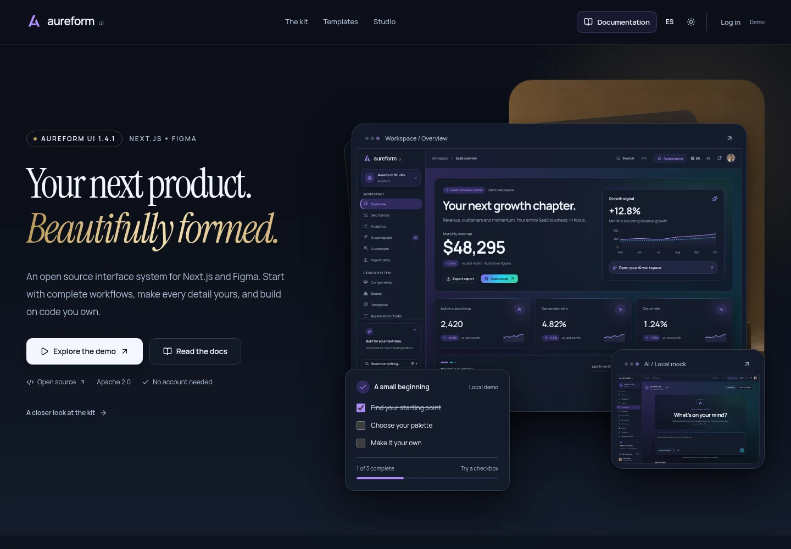

**69 views · 44 core component families · 107 registry entries · 6 palettes · 13 chart types · English / Español · Light / Dark**

Built with **Next.js 16, React 19, TypeScript, Tailwind CSS 4, Base UI, GSAP and Lenis**. Aureform-authored source is available under [Apache 2.0](LICENSE).

[](package.json) [](package.json) [](package.json) [](package.json) [](package.json) [](#get-started) [](package.json) [](https://aureformui.com/en/docs/) [](https://aureformui.com/en/docs/tokens/)

## What you get

[](https://aureformui.com/en/docs/data-table/) [](https://aureformui.com/en/docs/charts/) [](https://aureformui.com/en/forms/) [](package.json) [](https://aureformui.com/en/docs/maps/)

| Included                             | What you can build with it                                                                                                                                                       |
| ------------------------------------ | -------------------------------------------------------------------------------------------------------------------------------------------------------------------------------- |
| **68 suite views + a landing page**  | Dashboards, CRM, commerce, onboarding, customer operations, team settings, mail, chat, tasks and AI workspace interfaces.                                                        |
| **Components, blocks and templates** | Buttons, forms, dialogs, data tables, navigation, charts and composed workflows. Copy the source you need through the local CLI or shadcn registry.                              |
| **An appearance studio**             | Aurora, Violet, Ocean, Mint, Ember and Rose; colors, shades, gradients, materials, typography, radius, density and hover treatments. Save presets and export JSON, CSS or React. |
| **Six reusable effects**             | Gradient background, shader background, spotlight, glow border, tilt card and magnetic button, with reduced-motion handling and a static shader fallback.                        |
| **Design and content assets**        | A native Figma library, shared tokens, local fonts and 32 original images generated with GPT Image 2.5: portraits, organization avatars, products and editorial scenes.          |

| Light mode                                                                   | Appearance studio                                                                                               |
| ---------------------------------------------------------------------------- | --------------------------------------------------------------------------------------------------------------- |
| 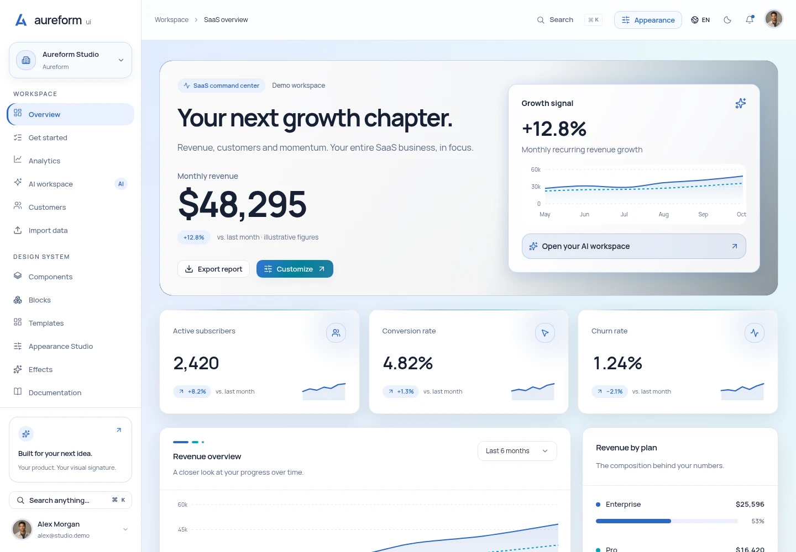 | 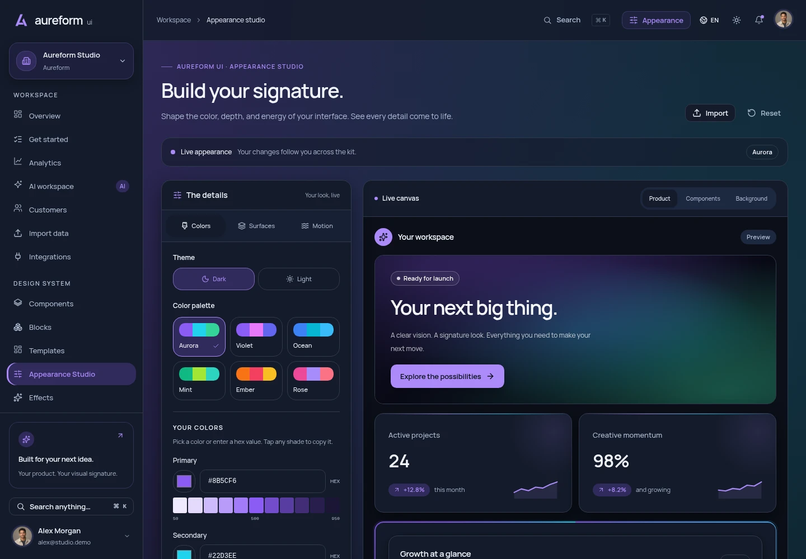              |
| **Charts**                                                                   | **Component library**                                                                                           |
| 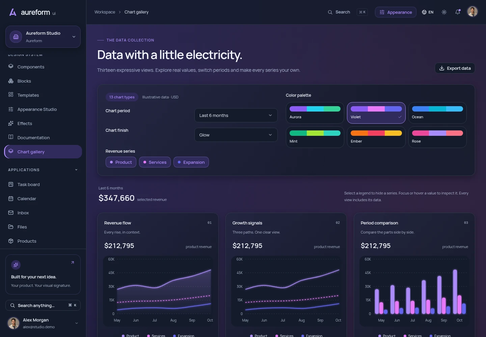                  | 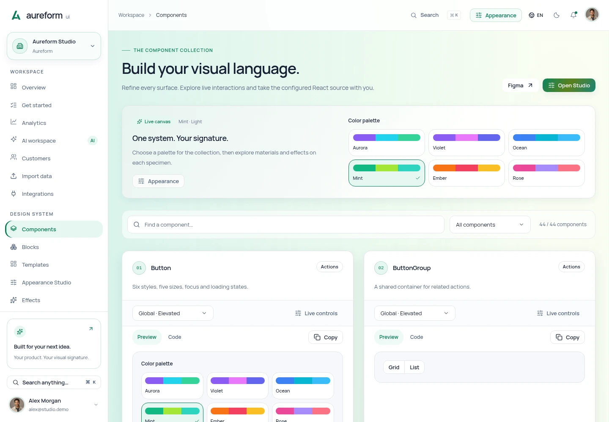 |

## Application workflows in 1.4

[](https://aureformui.com/en/docs/adapters/) [](https://aureformui.com/en/docs/maps/) [](https://aureformui.com/en/docs/authentication/)

Explore [Products](https://aureformui.com/en/products/), [Orders](https://aureformui.com/en/orders/), [Invoices](https://aureformui.com/en/invoices/), [Billing](https://aureformui.com/en/settings/billing/) and [Maps](https://aureformui.com/en/maps/).

The product editor includes a live preview and an image gallery with upload, crop, rotation, alt text, primary image and reordering. Catalog prices feed new orders; a successful mock payment updates inventory and creates an invoice. Billing has plan changes, history and a customer portal preview. The included typed Stripe adapter connects those screens to **your authenticated backend**.

Maps starts locally and can connect to Google Maps with a restricted browser key. [Sign in](https://aureformui.com/en/auth/sign-in/) and [sign up](https://aureformui.com/en/auth/sign-up/) expose **Google, GitHub and Microsoft mock buttons**, with callbacks for your own auth provider. Recovery and verification are available too. No real OAuth or payment is performed by the public demo.

| Product catalog                                                                                    | Social access                                                                                         |
| -------------------------------------------------------------------------------------------------- | ----------------------------------------------------------------------------------------------------- |
| 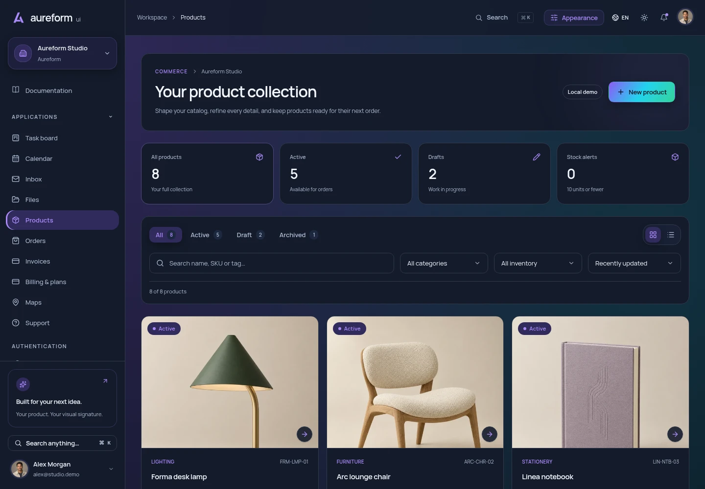 | 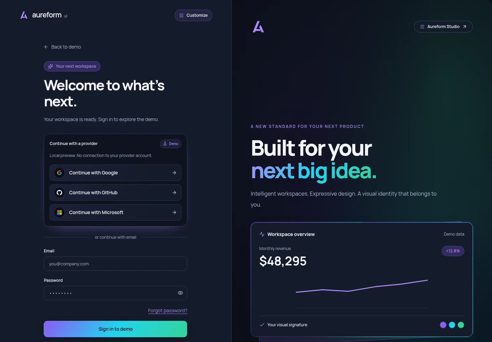    |
| **Billing and plans**                                                                              | **Maps workspace**                                                                                    |
| 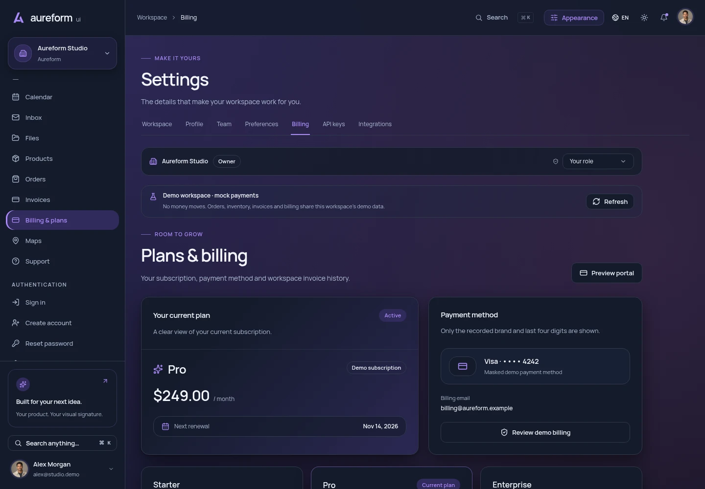      | 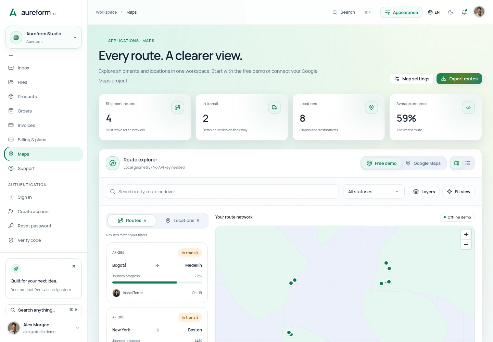 |

| Product image editor                                                                                   | Orders and checkout                                                                      |
| ------------------------------------------------------------------------------------------------------ | ---------------------------------------------------------------------------------------- |
| 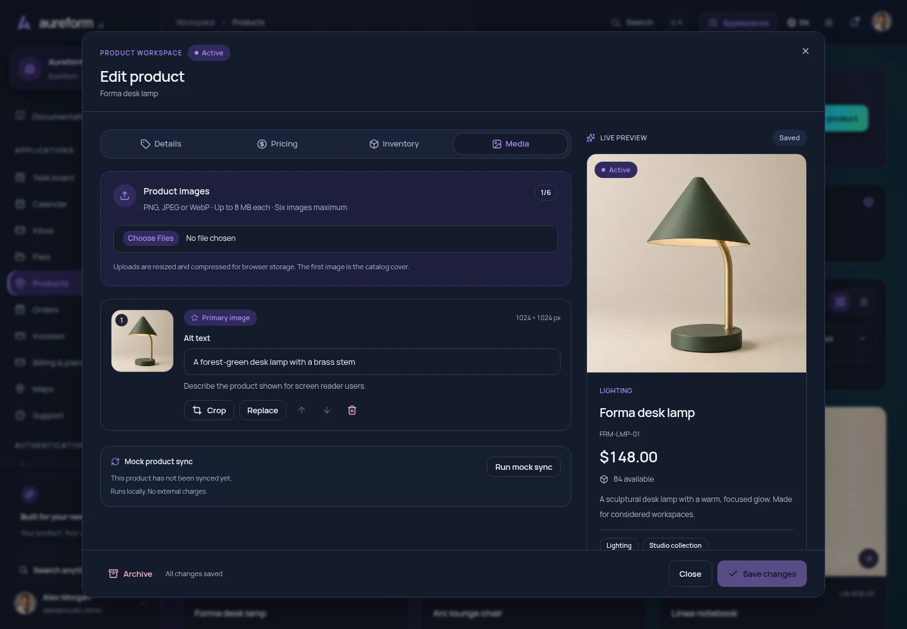 | 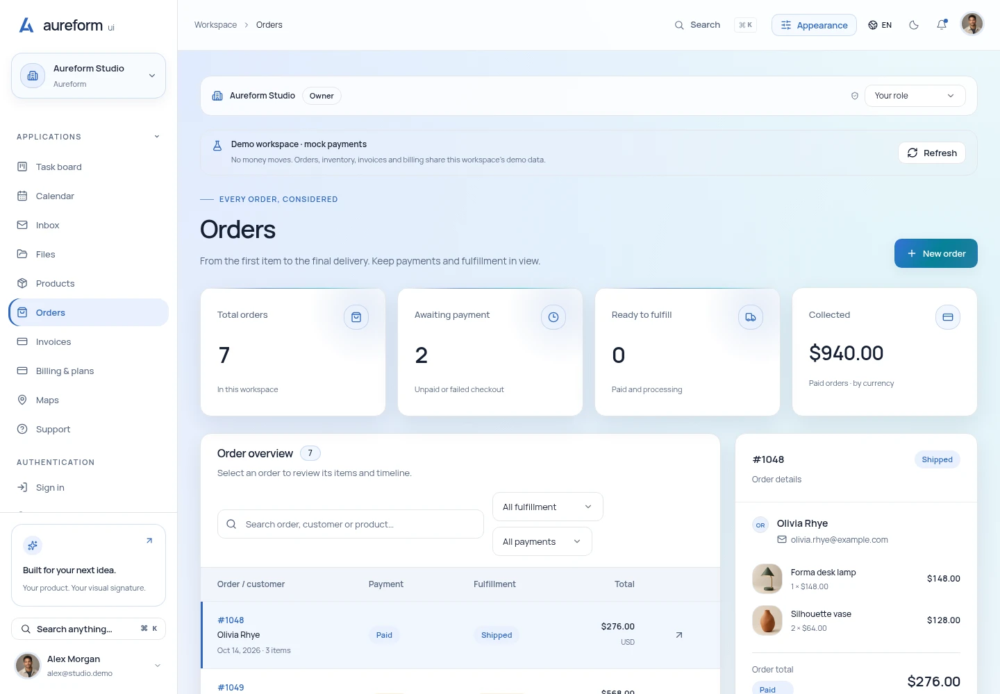 |

[Application contracts and integration examples →](docs/application-integrations.md) · [Español →](docs/application-integrations.es.md)

[1.4 validation and release scope →](docs/release-checklist-1.4.0.md)

## Get started

Use **Node.js 22.18.0+** and **pnpm 10**. The repository pins its pnpm version in `package.json`. If `corepack` is unavailable, install it first with `npm install --global corepack`; Node.js 25+ requires a separate install. See the [Corepack guide](https://github.com/nodejs/corepack#default-installs).

```sh
git clone https://github.com/terrizoaguimor/aureform-ui.git
cd aureform-ui
corepack enable
pnpm install --frozen-lockfile
pnpm dev
```

Open [localhost:3000/en/](http://localhost:3000/en/) or [localhost:3000/es/](http://localhost:3000/es/). The included images and fonts are local files; **running the suite requires no API keys**.

To build and preview the static export:

```sh
pnpm build
pnpm start
```

The output lives in `out/`. GitHub Pages uses the project prefix at build time:

```sh
NEXT_PUBLIC_BASE_PATH=/aureform-ui pnpm build
```

See the [GitHub Pages guide](docs/github-pages.md) for hosting and the [open-source guide](docs/open-source.md) for integration.

## Use it in your own project

**Create a small starting application.** Run the local CLI from this checkout:

```sh
node bin/aureform.mjs list
node bin/aureform.mjs init ../my-product --no-install
pnpm --dir ../my-product install
pnpm --dir ../my-product dev
```

**Add selected source.** Preview an addition before applying it:

```sh
node bin/aureform.mjs add data-workbench import-wizard customer-detail \
  --cwd ../my-product --dry-run
node bin/aureform.mjs add data-workbench import-wizard customer-detail \
  --cwd ../my-product
pnpm --dir ../my-product install
```

The CLI copies dependencies and reached assets, respects configured aliases and protects existing source. `--diff` shows proposed changes without writing. [CLI guide →](docs/cli-updates-1.2.md)

**Use the shadcn registry.** From a Next.js / Tailwind 4 project with shadcn configured:

```sh
pnpm dlx shadcn@4.22.0 add \
  https://aureformui.com/r/button.json
```

Browse the [107-entry registry](https://aureformui.com/r/registry.json). Components and blocks may require the supplied styles and locale or appearance providers; check their examples before integrating. [Registry guide →](docs/registry-compatibility.md)

## A frontend you can connect

The demo has interactive flows for filtering, saved views, CSV imports, onboarding, members and customer detail. Its records and preferences persist **in your browser**.

Production OAuth, server authorization, shared databases, email delivery, Stripe endpoints/webhooks and AI model calls are integrations you provide. The application kit supplies the frontend workflows, typed contracts and mock adapters. Role previews simulate permissions; they do not secure a backend. Customer-detail attachments store metadata, while the separate file-manager demo uses local browser storage.

Reusable operation blocks accept data and callbacks so you can connect your own services. Start with the [SaaS contracts](docs/saas-operations.md), [architecture](docs/architecture.md) and [component examples](examples/README.md).

<a id="figma-source-and-packages"></a>

## Design, motion and assets

[](docs/motion-runtime.md) [](docs/motion-runtime.md) [](docs/generated-images/README.md)

- **Figma:** [editable design library](https://www.figma.com/design/lHp5p10yGb7lqXJDnAox0N) and [repository design bundle / export notes](design/README.md). Consult those notes for the actual available files and their formats.
- **Appearance:** [configuration and exports](docs/appearance.md), [effects](docs/effects.es.md), [shaders](docs/shaders.md) and [charts](docs/charts.md).
- **Motion:** GSAP handles scoped entrances; Lenis is optional on the landing. Application screens retain native scrolling. [Runtime contract](docs/motion-runtime.md).
- **Images:** [32-image collection](docs/generated-images/README.md), [full prompts](docs/generated-images/catalog.json), [original WebP masters](design/images/masters/) and [asset manifest](public/assets/generated-images.json). Optimized WebP files are included; SVG companions embed the same raster pixels for text-based registry transport.

Versioned packaging and QA records retain their original scope. See the [open-source guide](docs/open-source.md#check-changes-and-contribute) for how to interpret them.

## Documentation and deployment

[](docs/cloudflare-deployment.md) [](docs/release-checklist-1.4.1.md) [](https://aureformui.com/en/docs/research/)

[Read the documentation](https://aureformui.com/en/docs/) without opening the demo workspace. Its 22 chapters cover installation, components, tokens, motion, charts, tables, application integrations, Figma and deployment, with searchable headings, a page outline and copyable code. Navigation is available in English and Spanish; references that retain their original language are identified on the page.

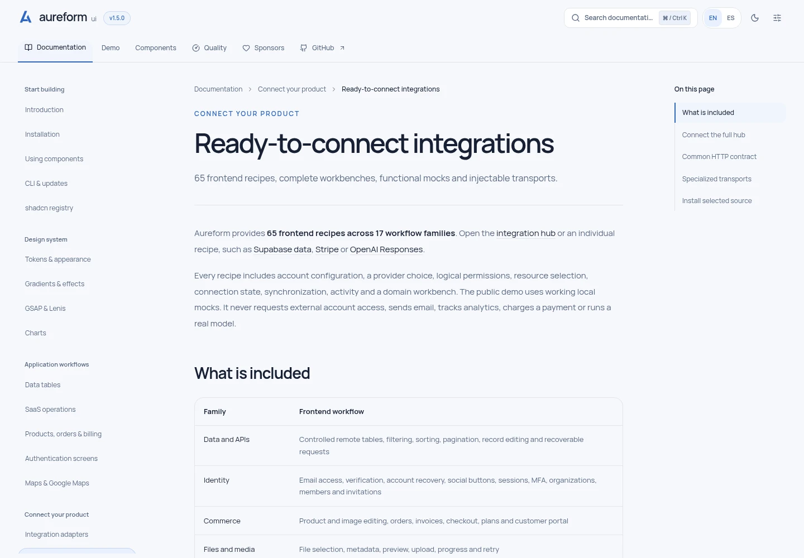

The primary site runs on **Cloudflare Workers Static Assets**. The [deployment guide](docs/cloudflare-deployment.md) describes the prebuilt export, custom domains and source-download redirect. [GitHub Pages](https://terrizoaguimor.github.io/aureform-ui/) remains a separate deployment with its own base path.

```sh
NEXT_PUBLIC_BASE_PATH="" pnpm build:cloudflare
pnpm exec cf deploy --prebuilt --dry-run
pnpm deploy:cloudflare
```

Set `NEXT_PUBLIC_SITE_URL` for your own canonical origin. Cloudflare deployment requires your account credentials; the demo and local build require none. Generated deployment state is excluded from Git and source packages.

The [bilingual product research](docs/website/en/research.md) combines three headless Gemini 4 Argon investigations, 52 observed searches, independent source review and eight priorities with acceptance criteria. Its [execution and verification ledgers](docs/research/2026-10-20/) separate recorded evidence from proposals that need user validation. The [original 20-finding study](docs/research-gaps-1.4.es.md) remains available.

## Quality you can inspect

[](https://github.com/terrizoaguimor/aureform-ui/actions/workflows/quality.yml)

<!-- BEGIN:quality-results -->
[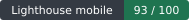](https://aureformui.com/en/quality/) [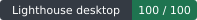](https://aureformui.com/en/quality/)

**Measured: 2026-10-20 05:47:39 UTC · Lighthouse 13.5.0 · commit [0caf7c8](https://github.com/terrizoaguimor/aureform-ui/commit/0caf7c8874ea8bb2b1580c0d59a9bda4497cbdd4).** Medians of three runs per page and device; scores out of 100.

| Page · Device | Performance | Accessibility | Best practices | SEO |
| --- | ---: | ---: | ---: | ---: |
| Landing · Mobile | 93 | 100 | 100 | 100 |
| Landing · Desktop | 100 | 100 | 100 | 100 |
| Documentation · Mobile | 94 | 100 | 100 | 100 |
| Documentation · Desktop | 100 | 100 | 100 | 100 |
| Demo dashboard · Mobile | 40 | 100 | 100 | 69 |
| Demo dashboard · Desktop | 67 | 100 | 100 | 69 |

[Methodology, metrics and all 18 reports →](https://aureformui.com/en/quality/) · [Original JSON and HTML](docs/quality/lighthouse/production-39375951507-1/)
<!-- END:quality-results -->

Each snapshot audits the landing, installation documentation and demo dashboard on mobile and desktop, three times per combination. Published values are medians of laboratory measurements. Raw HTML and JSON reports remain available in [the repository](docs/quality/lighthouse/) and on the website. See [the measurement guide](docs/quality/README.md) to reproduce or update them.

The demo dashboard deliberately remains `noindex`; its SEO result reflects that policy. Lighthouse accessibility checks cover the audited pages and do not certify the whole kit. Laboratory loading metrics are separate from field Core Web Vitals.

## Support the maintainer

[](https://github.com/sponsors/terrizoaguimor)

If Aureform helps your work, you can [sponsor the maintainer](https://github.com/sponsors/terrizoaguimor) through the existing personal GitHub Sponsors profile. Support is voluntary; the source, original assets and documentation remain open under Apache 2.0.

## Contribute

Help people find and evaluate the kit through relevant GitHub communities.
[Discovery research and eligible destinations](docs/github-discovery.md) include
maintained frontend lists, registry directories and focused submission drafts.
The repository's topics and About description identify its actual stack and
scope.

[](CONTRIBUTING.md) [](https://github.com/terrizoaguimor/aureform-ui/stargazers) [](https://github.com/terrizoaguimor/aureform-ui/forks) [](https://github.com/terrizoaguimor/aureform-ui/issues)

Bug reports, better interactions, new patterns, translations and documentation are welcome. English and Spanish contributions are both welcome.

Validation evidence for **v1.4.1**:

[](https://github.com/terrizoaguimor/aureform-ui/blob/v1.4.1/docs/qa-runtime-1.4.1.json) [](https://github.com/terrizoaguimor/aureform-ui/blob/v1.4.1/docs/qa-runtime-1.4.1.json) [](https://github.com/terrizoaguimor/aureform-ui/releases/download/v1.4.1/cloudflare-deployment-1.4.1.json)

```sh
pnpm typecheck
pnpm lint
pnpm test
pnpm verify:examples
pnpm build
```

Read [CONTRIBUTING](CONTRIBUTING.md) for browser checks and design conventions, our [Code of Conduct](CODE_OF_CONDUCT.md) for community expectations, and [SECURITY](SECURITY.md) for private vulnerability reporting.

## License and credits

Aureform-authored code, documentation and included original assets are released under [Apache License 2.0](LICENSE). See [NOTICE](NOTICE) and [THIRD_PARTY_NOTICES](THIRD_PARTY_NOTICES.md) for attribution and upstream licenses.

Created by [terrizoaguimor](https://github.com/terrizoaguimor). Build something useful, make it your own, and share improvements with the community.
