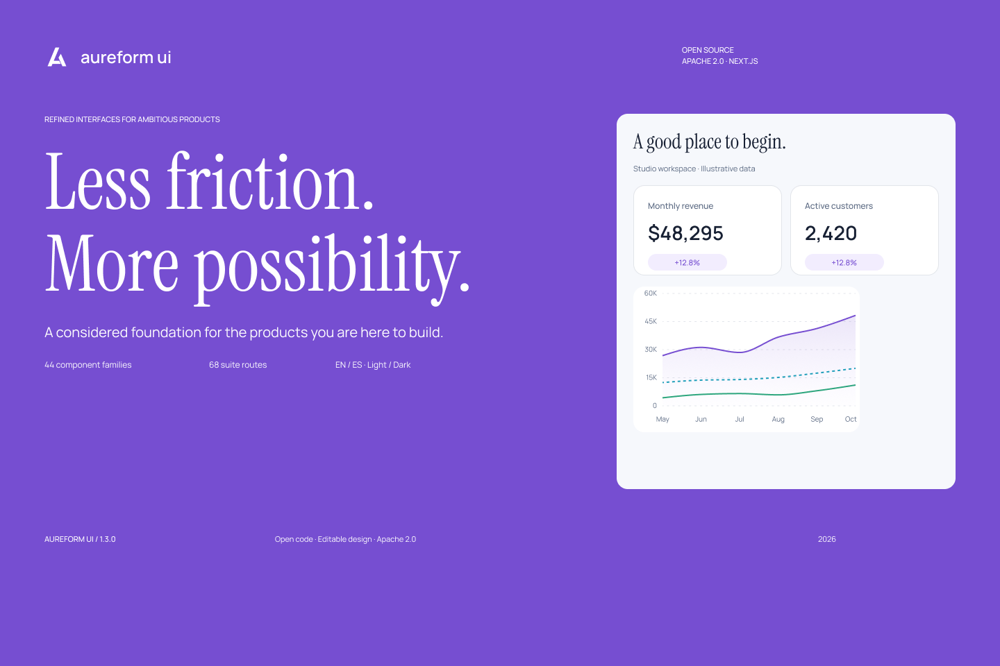

# El diseño de Aureform, abierto para todos


El propietario confirmó el 19 de octubre de 2026 el acceso público por enlace y los permisos de copia/exportación. El conector no permite comprobar esos ajustes de forma independiente.

[English](README.md) · [Código fuente](../README.md) · [Archivo de Figma](https://www.figma.com/design/lHp5p10yGb7lqXJDnAox0N)

El código y diseño originales de Aureform se distribuyen bajo [Apache 2.0](../LICENSE). Las fuentes y dependencias conservan sus licencias en [THIRD_PARTY_NOTICES.md](../THIRD_PARTY_NOTICES.md).



Empieza con el [paquete de diseño](downloads/aureform-design-snapshots.zip), o clona el repositorio para obtener el código, los tokens y los recursos de diseño juntos.

| Recurso | Qué puedes utilizar |
| --- | --- |
| [Archivo de Figma](https://www.figma.com/design/lHp5p10yGb7lqXJDnAox0N) | La biblioteca y plantillas nativas originales; acceso público por enlace y copia/exportación confirmados por el propietario. |
| [Plugin de reconstrucción](rebuild-plugin/README.md) | Un plugin local y abierto para recrear fundamentos y variantes iniciales nativas, e importar los SVG incluidos. |
| [Exportaciones SVG](exports/README.md) | Ocho exportaciones reales de Figma: tres plantillas, dos tableros de paletas y los conjuntos Button Shapes, Chart y Table. |
| [Mapa de rutas](maps/routes.md) | Las 69 raíces nativas registradas, con enlaces exactos a Figma y los puntos de entrada del código. |
| [Mapa de componentes](maps/components.json) | Las 92 asociaciones locales de Code Connect y sus archivos reales de código. |
| [Tokens](tokens/README.md) | El JSON del sistema y su CSS generado, con seis paletas y valores claros/oscuros. |
| [Colección de imágenes](images/README.md) | Retratos, productos e imágenes editoriales generadas, con prompts originales y metadatos de entrega. |
| [Pruebas nativas de imágenes](proofs/manifest.json) | Siete exportaciones aceptadas y congeladas del trabajo de imágenes en 1.2.1. |
| [Registro del cambio open source](release-1.3.0.json) | Los cambios de portada y licencia registrados por separado; las auditorías anteriores conservan su contexto histórico. |

Los SVG contienen geometría vectorial editable y fotografías incrustadas. Sus textos están convertidos en contornos. Importarlos **no** recupera auto-layout, propiedades de texto, variantes ni enlaces a variables de Figma. El plugin crea por separado textos editables y componentes iniciales nativos; su alcance documentado es menor que el de la biblioteca original completa.

**No se incluye un `.fig` nativo.** El conector disponible no exporta ese formato y la exportación de nodos con estructura REST no está soportada en este contexto de ejecución. Este paquete no renombra JSON ni SVG como `.fig`. Consulta los [detalles de distribución](../docs/figma-distribution.es.md).

Los archivos de Code Connect son **locales y no están publicados**. El código está en [`.figma/code-connect`](../.figma/code-connect); publicar este repositorio no los registra en Figma ni crea una conexión activa de Dev Mode. Los componentes importados o reconstruidos reciben IDs nuevos y necesitan sus propias asociaciones.

Actualiza los índices derivados y el paquete descargable desde un checkout completo:

```bash
python3 design/scripts/prepare_design.py --bundle
```

La actualización es local: no accede a Figma, no llama a un modelo de imágenes ni cambia las auditorías nativas históricas.
