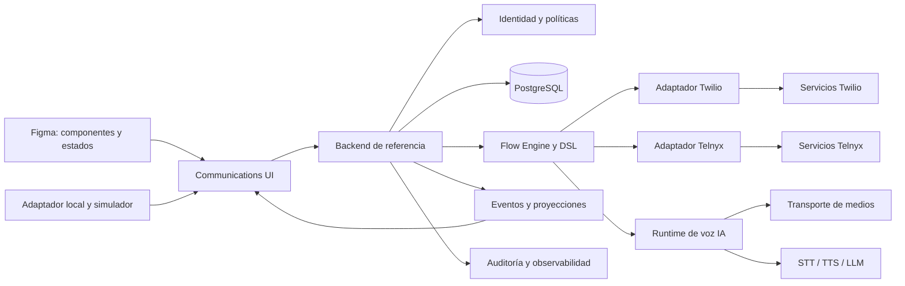

# RFC: arquitectura de Aureform Communications

Estado: **propuesta para revisión; no implementada**. Investigación consultada el **2026-10-20**, zona `America/Bogota`. Base de código: Aureform **1.5.0**, commit `6fa717365b81336603707d2742420906c878767d`.

Fuente de diseño: [tablero editable de arquitectura en Figma](https://www.figma.com/design/lHp5p10yGb7lqXJDnAox0N?node-id=341-732). Las fuentes nuevas y la recuperación de diseños anteriores están delimitadas en el [recibo nativo](../../design/reports/communications-2026-10-21.md).

[Investigación](RESEARCH.md) · [Capacidades](CAPABILITY-MATRIX.md) · [Flujos](FLOW-ENGINE-RFC.md) · [Seguridad](SECURITY-COMPLIANCE.md) · [Hoja de ruta](ROADMAP.md) · [Decisiones y experimentos](OPEN-QUESTIONS.md)

Esta entrega describe contratos y límites. Los ejemplos de TypeScript son borradores de diseño, no APIs exportadas ni integraciones operativas. Ningún proveedor ha pasado todavía pruebas de cuenta, audio o facturación de Aureform.

## 1. Decisión recomendada

Extender Aureform con módulos independientes y aditivos: UI editable, dominio tipado, dos adaptadores de proveedor, backend de referencia portable en Node/Docker, estado en tiempo real, motor de flujos, runtime de voz con IA y herramientas de observabilidad y pruebas. Mantener el sitio estático y las demos locales actuales.

El dominio común representa la intención y el estado observado. Cada adaptador conserva sus capacidades avanzadas, sus identificadores y sus reglas de control. No se ofrece migración transparente de una llamada activa, un número, una conexión SIP o una sesión de WhatsApp entre proveedores.

**Requisitos del usuario:** investigación documental open source para Twilio y Telnyx; Figma como fuente de diseño y paridad obligatoria, incluyendo pendientes de entregas anteriores; sin integración ni operación de producción en esta entrega. **Propuestas del plan por revisar:** alcance global mediante perfiles explícitos; backend de referencia Node/Docker; priorizar IA de voz portable frente a una dependencia obligatoria de IA alojada por el carrier.

**Hipótesis que validar:** un runtime común reduce trabajo duplicado sin convertir las capacidades de ambos carriers en el mínimo común. El MVP deberá demostrarlo con dos recorridos independientes, no con un adaptador real y otro simulado.

## 2. Lo que permite y lo que no permite el repositorio actual

Los hechos siguientes provienen de inspección de código, documentación, CLI y recibos de verificación del commit base. Su disponibilidad es **actual en el repositorio**; sus restricciones se indican en la última columna. Son evidencia de frontend, no de telecomunicaciones.

| Hecho verificado | Fuente de Aureform | Consecuencia y restricción |
| --- | --- | --- |
| Next exporta HTML estático, con `trailingSlash` y un prefijo configurable. | [next.config.ts](https://github.com/terrizoaguimor/aureform-ui/blob/6fa717365b81336603707d2742420906c878767d/next.config.ts), [guía local de despliegue](../cloudflare-deployment.md) | La demo Cloudflare/Pages puede permanecer estática; webhooks, secretos, tokens, audio y trabajos requieren servicios adicionales. |
| Los contratos de integración actuales usan familias acotadas, valores primitivos, registros, assets y resultados de herramientas. | [contracts.ts](https://github.com/terrizoaguimor/aureform-ui/blob/6fa717365b81336603707d2742420906c878767d/src/lib/integrations/contracts.ts) | No contienen piernas de llamada, reservas de agentes ni un protocolo de audio. No ampliarlos silenciosamente para fingir que los soportan. |
| `IntegrationScope.workspaceId` se entrega al adaptador. | [contrato de operaciones](../integrations/operations.md) | Es un identificador, no una autorización. El servidor debe comprobar pertenencia, recurso y acción. |
| El adaptador HTTP tiene orígenes confiables, cancelación, guardas de revisión, idempotencia y suscripción inyectable. | [http-adapter.ts](https://github.com/terrizoaguimor/aureform-ui/blob/6fa717365b81336603707d2742420906c878767d/src/lib/integrations/http-adapter.ts) | Reutilizar principios; no suponer que cancelar un `fetch` cancela una llamada o que existe un endpoint WebSocket universal. |
| El protocolo de IA existente es NDJSON v1 para texto y resultados de herramientas. | [contrato de IA](../integrations/ai.md), [ai-integration.ts](https://github.com/terrizoaguimor/aureform-ui/blob/6fa717365b81336603707d2742420906c878767d/src/lib/ai-integration.ts) | Conservarlo. Audio y propuestas de flujos necesitan contratos nuevos, sin reinterpretar mensajes antiguos. |
| `MotionSystem` tiene una clave formada por idioma y ruta, por lo que cambia el ciclo de vida de su subárbol. | [app-page.tsx](https://github.com/terrizoaguimor/aureform-ui/blob/6fa717365b81336603707d2742420906c878767d/src/components/app-page.tsx) | La futura sesión de voz no puede vivir dentro del contenedor que se remonta al navegar o cambiar idioma. |
| El grafo de distribución sigue también imports de tipos; resuelve dependencias desde el paquete raíz. | [source-graph.mjs](https://github.com/terrizoaguimor/aureform-ui/blob/6fa717365b81336603707d2742420906c878767d/scripts/lib/source-graph.mjs), [compatibilidad del registry](../registry-compatibility.md) | Evitar tipos de SDK en contratos universales. Un manifiesto opcional por sí solo no hace que el generador incluya esa dependencia. |
| La CLI copia código con recibos, guardas de sobrescritura y rollback local; no tiene una actualización remota con merge de modificaciones del consumidor. | [CLI](../cli-updates-1.2.md), [verificación de instalación](../integrations/installation-verification.md) | Diseñar IDs planos `communications-*`, ejemplos completos y actualización documentada. No prometer migraciones automáticas. |
| Mail, Chat y los workflows actuales son demostraciones de producto, con contratos reemplazables. | [arquitectura existente](../architecture.md), [workflows de producto](../integrations/product-workflows.md) | Reutilizar patrones de interacción; no presentarlos como una bandeja SMS/WhatsApp conectada. |
| Los registros históricos de pruebas cubren UI, contratos y bindings opcionales existentes. | [verificación](../verification.md), [recibo 1.5.0](../qa-runtime-1.5.0.json) | No demuestran control de carriers, audio bidireccional, KYC ni aislamiento del futuro backend. |

La inspección también identifica dos acoplamientos a evitar: compartir acciones de borrado a través de una plantilla comercial arrastra dependencias ajenas; la sincronización de registros por polling no es presencia telefónica en tiempo real. La propuesta añade pequeños bloques comunes y un contrato propio de presencia, sin refactorizar esas áreas durante esta fase.

## 3. Módulos, responsabilidades y dependencias

Todos los nombres de esta tabla son **propuestos**. No indican que esos paquetes ya estén disponibles en npm o en la CLI.

| Módulo | Responsabilidad | Dependencias permitidas | Qué no debe hacer |
| --- | --- | --- | --- |
| Communications UI | Softphone, listas, inbox, estados, editores y paneles controlados. | Primitivas Aureform, contratos de dominio y puertos inyectados. | Guardar secretos, comprar números o interpretar éxito local como éxito remoto. |
| Communications Domain Contracts | Identidades, capacidades, comandos, eventos, llamadas, mensajes, calendarios y consentimiento. | TypeScript y validación serializable; sin SDK de carrier. | Borrar diferencias de proveedor o convertir IDs externos en permisos. |
| Twilio Provider Adapter | API, webhooks, tokens, TwiML, Studio y extensiones TaskRouter/Conference. | SDK servidor opcional, transporte HTTP y contratos. | Importarse en el navegador con credenciales de cuenta. |
| Telnyx Provider Adapter | API v2, webhooks, tokens, Call Control, SIP/TeXML y extensiones propias. | SDK servidor opcional, transporte HTTP y contratos. | Mezclar modos de control incompatibles en una llamada. |
| Communications Backend Reference | Autorización, secretos, estado durable, políticas, routing, jobs y APIs de la UI. | Node, PostgreSQL, puertos de identidad y proveedor. | Convertirse en un SaaS obligatorio para usar el código open source. |
| Realtime Events and State | Proyecciones, suscripciones, cursor de recuperación y presencia con leases. | Backend autenticado y almacenamiento durable. | Suponer orden total, entrega única o conectividad constante. |
| Flow Engine / DSL | Propuestas, validación, simulación, ejecución y compilación versionada. | Contratos; puertos de políticas, recursos y adaptadores. | Ejecutar JavaScript, SQL o URLs inventadas por la IA. |
| Voice AI Runtime | Turnos, STT/TTS/LLM, interrupciones, herramientas y escalamiento. | Transporte de medios sustituible, servicios de modelos y herramientas autorizadas. | Asumir que un token de WebRTC permite operar cualquier recurso de otro tenant. |
| Observability, Audit and Testing | Correlación, métricas, trazas redactadas, fixtures y pruebas de compatibilidad. | Envelopes del dominio y puertos de exportación. | Publicar audio, transcripciones, prompts privados o credenciales en recibos de QA. |



El diagrama es una decisión de diseño de Aureform, no una descripción de infraestructura desplegada.

## 4. Contratos de dominio propuestos

### Conexión y capacidades

Una conexión pertenece a un tenant verificado por el servidor y a una cuenta del proveedor. Número, WABA, aplicación de voz y perfil de mensajería son bindings independientes. Los recursos globales de una cuenta no se exponen como si cualquier usuario del workspace pudiera administrarlos.

```ts
type Provider = "twilio" | "telnyx";
type CapabilitySupport =
  | "native"
  | "additional-infrastructure"
  | "partial"
  | "unavailable"
  | "unverified";

interface CapabilityEvidence {
  sourceUrl: string;
  consultedAt: string;
  availability: "documented" | "beta" | "account-gated" | "unknown";
  requirements: string[];
  restrictions: string[];
  runtimeEvidenceRef?: string; // Ausente hasta probar esta combinación.
}

interface CapabilityProfile {
  provider: Provider;
  connectionRef: string;
  businessCountry: string;
  destinationCountry?: string;
  numberType?: "local" | "mobile" | "toll-free";
  channel: "pstn" | "webrtc" | "sip" | "sms" | "mms" | "whatsapp";
  direction: "inbound" | "outbound";
  controlMode: string;
  browserProfile?: string;
  snapshotAt: string;
  capabilities: Record<string, {
    support: CapabilitySupport;
    evidence: CapabilityEvidence[];
  }>;
}

interface Money {
  currency: string;
  decimalAmount: string; // Evitar flotantes y redondeo a dólares enteros.
}
```

El perfil distingue país del número empresarial, destino, ubicación física y jurisdicción aplicable. `available`, `purchased`, `regulatory-pending` y `active` no son sinónimos. Las reglas de números deben consultarse al proveedor: Twilio advierte expresamente que no se codifique una copia fija de sus regulaciones. Disponibilidad documental; requisitos por país, tipo y usuario final. [Regulations API](https://www.twilio.com/docs/phone-numbers/regulatory/api/regulations), [requisitos Telnyx](https://developers.telnyx.com/docs/numbers/phone-numbers/regulatory-requirements), consulta 2026-10-20.

### Contactos, conversaciones y agentes

Proponer `Contact`, `ChannelAddress`, `Conversation`, `Message`, `Agent`, `Queue` y `QueueReservation` separados. Un contacto puede tener E.164, dirección SIP e identidades de WhatsApp diferentes. El caller ID no autentica a una persona. En WhatsApp, conservar identificadores del proveedor y de Meta en lugar de imponer que toda identidad sea un teléfono inmutable; la superficie exacta de identificadores nuevos debe verificarse por BSP antes de implementarla.

Una conversación puede agrupar mensajes y llamadas de varios proveedores a lo largo del tiempo. Cada sesión activa conserva su carrier y bindings. Deduplicar contactos requiere una política explícita; no fusionarlos automáticamente por un número compartido o reciclado.

La presencia de agente combina disponibilidad de negocio, conexión del dispositivo, permisos, capacidad y reservas. Un heartbeat de UI no demuestra que el micrófono funcione ni que el agente esté libre. Proponer leases con fencing tokens y una restricción transaccional por agente/capacidad; una reserva vencida con una llamada remota incierta no debe liberarse para un segundo carrier hasta reconciliarla.

### Sesión, piernas y estado

```ts
interface CallSession {
  id: string;
  tenantRef: string;
  provider: Provider;
  connectionRef: string;
  controlMode: string;
  flowRevisionRef: string;
  topology: "direct-browser" | "conference" | "sip-room";
  state:
    | "offered" | "queued" | "connecting" | "active"
    | "ending" | "ended" | "failed" | "unknown";
  legs: CallLeg[];
  revision: number;
}

interface CallLeg {
  id: string;
  role: "customer" | "agent" | "consultation" | "ai" | "voicemail";
  providerRef: string; // Referencia opaca, resuelta y autorizada en servidor.
  state:
    | "new" | "ringing" | "answered" | "bridged"
    | "held" | "ended" | "failed" | "unknown";
}

interface VoiceClientStatus {
  signaling: "disconnected" | "connecting" | "registered" | "recovering";
  microphone: "unknown" | "available" | "denied" | "lost";
  playback: "blocked" | "ready";
  token: "valid" | "refreshing" | "expiring" | "failed";
  localMute: boolean;
}
```

No hay una transición única `idle → active → completed` que cubra una transferencia atendida, una conferencia o un fallo de signaling. El cliente puede perder su conexión mientras la pierna PSTN sigue activa. `mute` local, `hold` de una pierna y audio de conferencia son acciones distintas.

**Hechos documentales que justifican separar los puertos:** el SDK Twilio ofrece mute y DTMF; el hold se controla mediante participantes de conferencia. El SDK Telnyx publicado ofrece hold/unhold de su llamada WebRTC. Las transferencias necesitan orquestación y eventos del servidor. Disponibilidad documentada, SDKs y aplicaciones configuradas obligatorios, interop y audio aún no probados. [Twilio Call](https://www.twilio.com/docs/voice/sdks/javascript/twiliocall), [Conference Participant](https://www.twilio.com/docs/voice/api/conference-participant-resource), [Telnyx Call](https://team-telnyx.github.io/webrtc/classes/Call.html), [transfer Telnyx](https://developers.telnyx.com/api-reference/call-commands/transfer-call), consulta 2026-10-20.

### Eventos y comandos

```ts
interface CommunicationEvent {
  schemaVersion: "1";
  id: string;                 // ID interno del inbox durable.
  provider: Provider;
  providerEventId?: string;    // No todas las superficies lo aportan.
  tenantRef: string;
  connectionRef: string;
  kind: string;
  occurredAt?: string;
  receivedAt: string;
  sessionRef?: string;
  flowRevisionRef?: string;
  nodeRef?: string;
  correlationRef: string;
  payload: unknown;            // Validado por kind/schema, no pasado a UI en bruto.
}

interface CommandResult {
  operationRef: string;
  status: "accepted" | "pending" | "completed" | "failed" | "unknown";
  stateRevision?: number;
  retryPolicy: "never" | "reconcile-first" | "safe-with-same-key";
}
```

El servidor registra clave de idempotencia, tenant, acción, hash de payload, resultado conocido y expiración. Reusar una clave con otro payload devuelve conflicto. Un timeout después de enviar `dial` puede significar que el carrier creó la llamada: reconciliar antes de repetir. No prometer exactly once.

Telnyx limita la deduplicación de `command_id` a una ventana y contexto concretos; los eventos pueden llegar duplicados o desordenados. Twilio Event Streams tiene sus propias reglas, que no deben extrapolarse a todos los callbacks clásicos. Disponibilidad documental, firmas y storage durable obligatorios; no probados en Aureform. [Telnyx webhooks de voz](https://developers.telnyx.com/docs/voice/programmable-voice/receiving-webhooks), [Twilio Event Streams](https://www.twilio.com/docs/events/event-delivery-and-duplication), consulta 2026-10-20.

## 5. Puertos y extensiones sin perder funcionalidades

Proponer puertos separados `NumberProvider`, `VoiceControlProvider`, `VoiceClient`, `MessagingProvider`, `WhatsAppProvider`, `MediaTransport`, `CapabilityResolver` y `FlowCompiler`. El backend compone los que la cuenta y el perfil realmente permiten.

El adaptador de navegador recibe un token emitido para el agente autorizado, no credenciales de cuenta. No incluir SDKs Twilio/Telnyx en un import universal de Aureform. Las recetas de consumidor podrán añadir SDKs y sus manifiestos explícitamente, una vez probado el resolver de distribución.

Las extensiones avanzadas serán tipadas y namespaced, por ejemplo `twilio.taskRouter`, `twilio.studio`, `telnyx.callControl` o `telnyx.whatsapp.coexistence`. La UI muestra capacidades no compartidas cuando existe el puerto correspondiente. Una feature no soportada devuelve un diagnóstico antes de crear recursos; no se convierte en una acción vacía.

**Control mode:** asignarlo al inicio de una sesión y mantenerlo. Telnyx documenta que no se deben combinar TeXML y Call Control sobre la misma llamada. Sin embargo, sus guías actuales permiten adjuntar IA desde Call Control, en conflicto con una afirmación general de un artículo de soporte anterior. Proponer perfiles por versión y modo; resolverlo con prueba antes de certificar IA nativa. [Compatibilidad de modos](https://support.telnyx.com/en/articles/8118086-texml-and-telnyx-voice-api-compatibility), [guía actual de AI Assistant](https://developers.telnyx.com/docs/voice/programmable-voice/ai-assistant-start), consulta 2026-10-20; disponibilidad documental contradictoria, habilitación de cuenta y experimento pendientes.

## 6. Backend de referencia y secuencia de una llamada entrante

Proponer un deployment Docker compuesto por API Node, worker de comandos/timers, PostgreSQL y reverse proxy HTTPS. La identidad es un puerto OIDC: se puede conectar el proveedor del consumidor. Un perfil de laboratorio Keycloak es opcional; `start-dev` no es configuración de producción. [Guía Keycloak Docker](https://www.keycloak.org/getting-started/getting-started-docker), [OIDC Core](https://openid.net/specs/openid-connect-core-1_0.html), consulta 2026-10-20; tecnologías disponibles, configuración segura y autorización de recursos siguen siendo responsabilidad del backend.

Tablas conceptuales: conexiones y bindings; capacidad/versiones; inbox de eventos; comandos/outbox; sesiones y piernas; reservas de agentes; timer jobs; conversaciones/mensajes; consentimientos; propuestas/revisiones de flujo; aprobaciones y auditoría. Proponer índices que incluyan tenant y claves únicas que impidan duplicados dentro de su ámbito.

Secuencia del MVP:

1. El proveedor recibe una llamada en un número ya autorizado y vinculado.
2. El endpoint verifica firma, cuenta y binding antes de resolver el tenant. Para solicitudes de instrucciones devuelve XML válido dentro del deadline; los avisos asíncronos se persisten antes de confirmar recepción.
3. Se fija versión de flujo, zona horaria, calendario y política de operación. Fuera de horario se reproduce el mensaje aprobado y se termina la llamada.
4. Dentro de horario se inserta en FIFO. La posición y el límite de espera pertenecen al dominio; mantener audio de espera consume minutos del carrier.
5. El dispatcher reserva capacidad del agente mediante transacción. La UI autenticada recibe una oferta y contesta con el SDK correspondiente.
6. El adaptador conecta las piernas según la topología del proveedor. El historial muestra `connecting` hasta observar la conexión real, no solo la aceptación del comando.
7. Los webhooks y el estado del cliente se reconcilian; un timeout de reserva devuelve al llamante a una política explícita de cola/overflow.
8. Se confirma el final de las piernas pertinentes y se libera la capacidad. Las notas/disposiciones son datos del backend, independientes del SDK.

Proponer SQL durable antes de Redis obligatorio. `SKIP LOCKED` puede servir a consumidores de una cola de trabajo, pero no es una garantía de consistencia para consultas generales. [PostgreSQL SELECT](https://www.postgresql.org/docs/current/sql-select.html), consulta 2026-10-20. Temporal es una alternativa futura para procesos largos y compensaciones; impone requisitos de determinismo y actividades para I/O. [Temporal workflow definition](https://docs.temporal.io/workflow-definition), misma consulta. No se selecciona como dependencia del MVP.

## 7. Realtime, recuperación y ciclo de vida del softphone

Proponer SSE o WebSocket autenticado para proyecciones, con cursor durable, snapshot inicial y recuperación de gaps. El transporte no concede permisos: cada suscripción valida tenant, agente y recurso. Un evento publicado puede ser repetido; el cliente usa revisión y correlación.

Crear en una futura implementación un `VoiceSessionHost` estable fuera del remount de ruta/idioma. Montarlo solo en la aplicación de comunicaciones, sin cargar SDKs en la landing o documentación. Navegación y cambio de idioma conservan la sesión; logout, cambio de tenant o pérdida de permisos requieren una política de terminación/entrega explícita.

El SDK Twilio documenta limitaciones de segundo plano en navegadores móviles. Telnyx documenta notificaciones push nativas, que no prueban esa capacidad en el navegador JS. El MVP se certificará primero en escritorio; móvil web permite uso en primer plano solo en combinaciones probadas. [Navegadores Twilio](https://www.twilio.com/docs/voice/sdks/javascript#supported-browsers), [Telnyx WebRTC](https://team-telnyx.github.io/webrtc/classes/TelnyxRTC.html), [push nativo](https://developers.telnyx.com/docs/voice/webrtc/push-notifications), consulta 2026-10-20; disponibilidad parcial y pruebas por versión pendientes.

No aplicar un TTL idéntico por suposición: Twilio permite configurar duración dentro de su límite, mientras que Telnyx documenta JWT limitado por la credencial de telefonía y su expiración. La renovación de audio activo es un gate del experimento SDK. [Access Tokens Twilio](https://www.twilio.com/docs/iam/access-tokens), [JWT Telnyx](https://developers.telnyx.com/docs/voice/webrtc/auth/jwt), consulta 2026-10-20.

## 8. Voz con IA: plano de medios separado

El runtime portable se evalúa después de demostrar la vertical de telefonía. Proponer LiveKit Agents JS/TS con transporte SIP y servicios de medios reemplazables; no obligar al consumidor a un proyecto LiveKit Cloud. Las guías oficiales contemplan trunks de ambos carriers, pero integrar SIP no proporciona por sí solo ACD, consentimiento, historial o autorización. [Proveedores SIP](https://docs.livekit.io/telephony/start/providers/), consulta 2026-10-20; disponibilidad documental, trunks, SFU/SIP server, red y codecs son dependencias adicionales.

El conector Twilio por WebSocket de LiveKit exige **LiveKit Cloud**; no sirve como baseline autoalojado. [Twilio Connector](https://docs.livekit.io/telephony/connectors/twilio/), misma consulta. Mantenerlo como alternativa opcional, con su propia matriz y costos.

Una sesión `sip-room` para IA y un softphone conectado al SDK nativo no tienen una transferencia universal entre sí. El experimento deberá elegir y demostrar: unir al humano a la misma sala, usar REFER con permisos del trunk o controlar una conferencia compatible. No cambiar el carrier activo ni declarar warm transfer por haber conectado un bot.

Twilio Media Streams y Telnyx Media Streaming ofrecen superficies diferentes de codecs, buffering y señalización. Un puerto de medios describe esas diferencias; los puertos STT/TTS/LLM no reciben un formato supuesto común. [Twilio Streams](https://www.twilio.com/docs/voice/media-streams), [Telnyx Streaming](https://developers.telnyx.com/docs/voice/programmable-voice/media-streaming), consulta 2026-10-20; requisitos WSS y runtime de audio; latencia y handoff no medidos.

No distribuir pesos como Apache 2.0 por el mero hecho de que el SDK lo sea. Las condiciones de modelos de LiveKit y la anotación de un artefacto Silero requieren resolver procedencia/licencia antes de empaquetarlo. [MODEL_LICENSE](https://raw.githubusercontent.com/livekit/agents-js/main/MODEL_LICENSE), [REUSE.toml](https://raw.githubusercontent.com/livekit/agents-js/main/REUSE.toml), consulta 2026-10-20; compatibilidad de distribución **pendiente**. Las alternativas y el registro completo están en [RESEARCH.md](RESEARCH.md).

## 9. Figma, UI y paridad con Aureform

Fuente nativa: [biblioteca Aureform en Figma](https://www.figma.com/design/lHp5p10yGb7lqXJDnAox0N). La auditoría de esta entrega verifica que las páginas existentes llegan a la suite 1.1–1.3; los mapas congelados no certifican paridad con todas las ampliaciones 1.4/1.5. [Registro de distribución](../figma-distribution.md), [mapa histórico](../../design/maps/routes.md). Disponibilidad: archivo nativo accesible por el conector; publicación de Code Connect y descarga `.fig` no demostradas.

**Requisito del usuario, no opcional:** completar los pendientes de diseño de funcionalidades ya implementadas y establecer paridad antes de sumar nuevas pantallas productivas. Preservar los IDs válidos y la evidencia histórica; añadir un registro de reconciliación nuevo, sin reescribir un recibo antiguo como si fuera una revisión actual.

Para cada pantalla y bloque futuro se exige una correspondencia:

`source path + source hash ↔ Figma file/page/node ↔ variantes/estados ↔ ejemplos ↔ evidencia visual y funcional`.

La paridad incluye semántica de controles, labels EN/ES, desktop/móvil, Light/Dark, tokens de seis paletas, estados de conexión/permisos y flujos de recuperación. Una captura plana de UI, un SVG con texto delineado o el mismo número de componentes no equivalen a masters editables con props y bindings. Los efectos GSAP y el comportamiento WebRTC deben tener especificación de interacción y prueba en código; Figma por sí solo no ejecuta ni certifica esas conductas.

| Pantalla propuesta | Bloques principales | Límite demo/productivo y estados críticos |
| --- | --- | --- |
| Number Manager | Búsqueda, capacidades, requisitos, compra, bindings y portabilidad. | Local: inventario ficticio. Conectada: quote vigente y aprobación antes de comprar/liberar. Regulatory pending y port failed visibles. |
| Unified Inbox | Contacto, timeline multicanal, composer, archivos y consentimiento. | No mostrar delivery como read. Sesión WhatsApp cerrada exige plantilla autorizada; errores no sustituyen silenciosamente el backend por mocks. |
| Softphone | Dispositivo, oferta, teclado DTMF, mute, audio y acciones habilitadas. | Diferenciar signaling, permiso de micrófono, playback y llamada remota. Botón hold/transfer solo con capability y topología demostradas. |
| Call History | Sesión/piernas, duración, notas, disposición y auditoría. | Mostrar estado desconocido y reconciliación. Grabación/transcripción solo con permisos y retención aplicable. |
| Agent Workspace | Inbox, contexto CRM, llamada, notas y disponibilidad. | La disponibilidad comercial no suplanta el estado del dispositivo o una reserva del dispatcher. |
| Queue Manager | Agentes, prioridades, skills, capacidad y overflow. | FIFO compartida inicial; estrategias avanzadas por adapter/backend. Mostrar reservas vencidas y llamadas aún vivas. |
| Business Hours & Holidays | Zona IANA, semana, festivos, excepciones y simulador de fecha. | Cobertura por año y fuentes. Calendar missing no se convierte en “abierto” sin una política aprobada. |
| Flow Builder | Canvas/lista, inspector, diagnósticos, simulación, diff y versiones. | Editar es local; publicar requiere bindings, validaciones y aprobación de costos. |
| AI Agent Studio | Prompt, voz, modelos, RAG, herramientas, pruebas y handoff. | Configuración de demo y conexión real explícitas. Consentimiento, fallos de modelos y límite de gasto visibles. |
| Campaign Dialer | Lista, consentimiento, horario legal, cadencia y resultados. | Sin campañas reales en demo. Primer dialer secuencial; no predictive dialer implícito. |
| Supervisor Dashboard | Colas, presencia, SLA, KPIs, alertas y acciones permitidas. | Eventos retrasados/estimaciones etiquetados. Escucha y grabación no habilitadas por defecto. |
| Provider Settings | Conexiones, secretos, perfiles, cobertura, límites y pruebas. | Credenciales nunca en frontend. Demostrar habilitación, no pintar “connected” tras guardar un nombre de cuenta. |

Todas las pantallas deben diseñar `loading`, `empty`, `error`, `disconnected`, `permission denied` y `recovery`, además del estado nominal. Mantener navegación por teclado, foco visible, labels no dependientes del color, zoom y alternativa de lista al canvas.

Conservar el contrato visual actual: Manrope/Instrument Serif, tokens, shades, hover, gradientes y sombras. Reservar movimiento para feedback útil, con `prefers-reduced-motion`; scrolling nativo en aplicaciones. No emitir anuncios ARIA ni renders globales a la frecuencia de paquetes de audio. [Guía de contribución](../../CONTRIBUTING.md), [motion runtime](../motion-runtime.md), [apariencia](../appearance.md), consulta 2026-10-20; normas actuales del proyecto.

## 10. Distribución, licencias y compatibilidad pública

Los componentes originales, DSL y backend escritos por Aureform pueden mantenerse bajo Apache 2.0. Dependencias, codecs, pesos y servicios conservan sus licencias y condiciones; “todo abierto” no permite relicenciar material de terceros.

Separar distribuciones futuras:

- Recetas UI/contratos/simulador copiables por la CLI, sin cuentas ni claves.
- Ejemplos de consumidor con dependencias opcionales, manifiesto, lock y configuración segura.
- Backend Node/Docker de referencia, con perfiles locales y checklist de configuración productiva.
- Fixtures sanitizados y pruebas de provider compatibility ejecutadas por el consumidor con cuentas autorizadas.
- Fuente nativa Figma y mapas actuales, con Code Connect solo declarado publicado cuando exista evidencia de registro.

No entregar WAV/MP3/WEBM a través de una suposición sobre el registry actual: su entrega publicada es textual. Los assets binarios deberán tener un mecanismo explícito y licencia, o generarse/configurarse en el consumidor. No modificar durante esta fase el resolver, el catálogo ni el router.

## 11. Alternativas evaluadas y descartadas como base

| Alternativa | Motivo de no seleccionarla como baseline | Cuándo conservarla |
| --- | --- | --- |
| Wrapper único de APIs con mocks | Oculta topology, billing y fallo real; no demuestra end-to-end. | Fixtures para demos y pruebas deterministas. |
| Flex obligatorio | Buena solución comercial Twilio, pero acopla el runtime principal a un carrier. | Adaptador avanzado para clientes Flex existentes. |
| Studio/TeXML como DSL universal | Los catálogos y equivalencias no cubren todo el dominio. | Compilación de subconjuntos demostrados, sin degradación silenciosa. |
| Construir SIP/PBX/media desde cero | Amplía mucho operaciones, seguridad e interoperabilidad antes del primer resultado. | Solo si un requisito futuro no puede resolverse con servicios existentes. |
| n8n como motor distribuido de Aureform | Su licencia no es una licencia OSI y la ejecución de jobs no resuelve audio en tiempo real. | Integrar una instancia del consumidor con autorización/licencia adecuada. |
| Pipecat como segunda dependencia obligatoria | Alternativa portable válida, pero añade Python a la referencia Node/TypeScript propuesta. | Evaluación si los plugins o métricas demuestran una ventaja concreta. |
| SDKs globales en el shell | Afecta distribución, bundle y ciclo de vida del sitio actual. | Carga opcional en la aplicación del consumidor. |
| Failover que mueve llamadas activas entre carriers | No hay equivalencia transparente de recursos/sesiones. | Routing de **nuevas** llamadas a recursos alternativos ya habilitados y aprobados. |

Las fuentes, licencias y disponibilidad de estas alternativas están documentadas en [RESEARCH.md](RESEARCH.md); las alternativas son decisiones propuestas de Aureform, no defectos universales de esos productos.

## 12. Gate para iniciar desarrollo

Recomendar iniciar solo la fase de contratos/simulador y el MVP acotado cuando se aprueben el RFC y su plan de pruebas, se cierre la paridad Figma aplicable, exista país/perfil de laboratorio elegible, identidad/aislamiento estén definidos y el usuario autorice los recursos y el presupuesto concretos.

No iniciar campañas, compra automática, grabación, WhatsApp Calling ni IA con tools reales por haber aprobado esta investigación. Cada fase conserva su propio gate de seguridad, elegibilidad, costos y evidencia independiente por proveedor.
