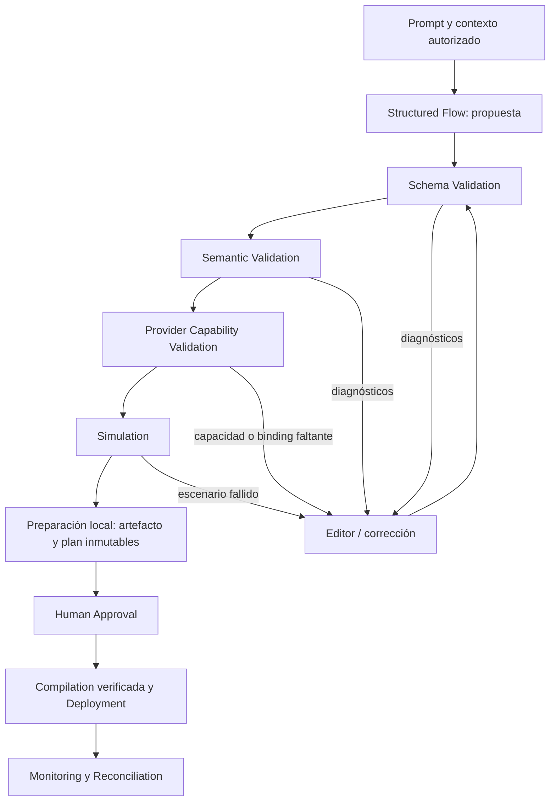

# RFC: Flow DSL, editor y Prompt-to-Flow

Estado: **diseño propuesto, sin runtime ni compiladores implementados**. Consulta documental: **2026-10-20**, `America/Bogota`. Las capacidades descritas de proveedores son documentales; no se han publicado flujos ni ejecutado llamadas en sus cuentas.

Fuente de diseño: [tablero editable de Flow DSL y Prompt-to-Flow](https://www.figma.com/design/lHp5p10yGb7lqXJDnAox0N?node-id=341-750) y [composición del editor](https://www.figma.com/design/lHp5p10yGb7lqXJDnAox0N?node-id=319-486). El editor muestra un extracto del grafo, no una implementación del runtime. Ver [evidencia y límites](../../design/reports/communications-2026-10-21.md).

[Investigación](RESEARCH.md) · [Capacidades](CAPABILITY-MATRIX.md) · [Arquitectura](ARCHITECTURE-RFC.md) · [Seguridad](SECURITY-COMPLIANCE.md) · [Hoja de ruta](ROADMAP.md) · [Experimentos](OPEN-QUESTIONS.md)

## 1. Objetivo y límite de autoridad

Permitir describir una operación de comunicaciones en lenguaje natural y obtener una **propuesta estructurada**, editable, validable y simulable. La propuesta no es una autorización. La IA no compra números, no llama, no envía campañas, no concede permisos y no publica por sí misma.

**Propuesta por revisar:** una representación declarativa de Aureform como fuente canónica; editor visual y vista de lista como dos formas de editar el mismo AST; un runtime portable para ejecutar la semántica común. Los compiladores nativos propuestos solo aceptarían subconjuntos cuya equivalencia esté demostrada por proveedor.

El diseño y los estados del editor deben tener fuente editable en la [biblioteca Figma de Aureform](https://www.figma.com/design/lHp5p10yGb7lqXJDnAox0N). Una imagen del canvas no sustituye componentes, propiedades, estados de validación, inspector, navegación por teclado o revisión de publicación.

## 2. Bases verificadas y diferencias reales

Cada fila registra **hechos documentales** consultados el 2026-10-20. “Disponible” describe la superficie del producto, no soporte probado en Aureform.

| Base | Disponibilidad | Requisitos y restricciones | Fuente |
| --- | --- | --- | --- |
| Studio admite definiciones JSON con estados y transiciones, validadas por su esquema. | API Studio v2 documentada; catálogo de widgets propio. | Cuenta Twilio; no aceptar nodos Aureform como si fueran widgets Studio. | [Flow Definition](https://www.twilio.com/docs/studio/rest-api/v2/flow-definition), [REST v2](https://www.twilio.com/docs/studio/rest-api) |
| Studio tiene una operación Validate y revisiones de Flow. | Documentado. | Validate no crea ni publica una revisión; rollback requiere leer una definición y publicarla de nuevo. No se invocó la API aquí. | [Flow Validate](https://www.twilio.com/docs/studio/rest-api/v2/flow-validate), [Flow Revision](https://www.twilio.com/docs/studio/rest-api/v2/flow-revision) |
| TeXML tiene un subconjunto y extensiones diferentes de TwiML. | Documentado. | La tabla excluye, entre otros, `Client`, `Room`, `VirtualAgent` y `Pay`. El modo de una llamada limita comandos combinables. | [Compatibilidad TeXML/TwiML](https://developers.telnyx.com/docs/voice/programmable-voice/texml-twiml-compatibility), [modos TeXML/Voice API](https://support.telnyx.com/en/articles/8118086-texml-and-telnyx-voice-api-compatibility) |
| Telnyx anuncia Conversation Workflows para AI Assistants. | Anunciado en release notes; equivalencia del AST y API de publicación no verificada. | No diseñar un compilador a partir de una captura del builder o del antiguo Telnyx Flow. | [Anuncio oficial](https://telnyx.com/release-notes/conversation-workflows-ai-assistants) |
| JSON Schema 2020-12 ofrece una base de validación serializable. Zod puede exportar esquemas compatibles, con tipos no representables. | Especificación y API documentadas. | Evitar transforms, funciones y tipos no JSON. El manifiesto declara `^4.3.5`; el lockfile y la instalación resuelven **4.6.7**. Validar el subconjunto con la versión resuelta, sin cambiar dependencias en esta fase. | [JSON Schema](https://json-schema.org/draft/2020-12), [Zod JSON Schema](https://zod.dev/json-schema), [lockfile](../../pnpm-lock.yaml) |
| Salidas estructuradas de modelos pueden limitar sintaxis/esquema. | Documentadas; soporte depende del modelo y API. | Un JSON válido no prueba recursos, permisos, semántica, costos ni ausencia de alucinaciones. Manejar refusals y truncamiento. | [OpenAI Structured Outputs](https://developers.openai.com/api/docs/guides/structured-outputs), [Gemini Structured Output](https://ai.google.dev/gemini-api/docs/structured-output) |
| React Flow ofrece un editor de nodos, handles y herramientas de accesibilidad. | Core MIT. Recursos Pro separados. | El editor no es un runtime de telefonía ni un motor durable. Revisar teclado, labels y alternativa de lista en nuestra composición. | [Licencia](https://raw.githubusercontent.com/xyflow/xyflow/main/LICENSE), [accesibilidad](https://reactflow.dev/learn/advanced-use/accessibility), [computing flows](https://reactflow.dev/learn/advanced-use/computing-flows), [Pro](https://reactflow.dev/pro) |
| Las zonas horarias y los festivos son fuentes distintas. | IANA y normas/calendarios públicos disponibles. | La zona no incluye festivos; el año, región y excepciones deben ser explícitos. | [IANA](https://www.iana.org/time-zones/), [Ley 51 de 1983, Colombia](https://www1.funcionpublica.gov.co/eva/gestornormativo/norma.php?i=4954), [calendarios regionales británicos](https://www.gov.uk/bank-holidays) |

**Hipótesis:** React Flow core con componentes nativos de Aureform permitirá una buena experiencia sin incorporar recursos Pro ni una licencia restrictiva. Validarla con grafos representativos, móviles, teclado y memoria, antes de adoptarlo como dependencia distribuida.

## 3. Pipeline con fronteras verificables



| Etapa propuesta | Entrada y salida | Qué bloquea el paso siguiente |
| --- | --- | --- |
| Prompt | Texto, idioma, objetivo y contexto de recursos que el actor puede ver. | Instrucciones no autorizadas, ambigüedades que afectan costos o políticas. |
| Structured Flow | `FlowProposal`: AST, supuestos explícitos, bindings sin resolver y referencia de generación. | Refusal, JSON incompleto, nodos fuera del catálogo. |
| Schema Validation | JSON/AST serializable, límites de tamaño y tipos. | IDs repetidos, propiedades extra prohibidas, tipos o versiones inválidos. |
| Semantic Validation | Grafo, variables, calendarios y reglas de dominio. | Rutas sin salida, ciclos no acotados, puertos faltantes, referencias inválidas. |
| Provider Capability Validation | Snapshot de cuenta/país/canal/modo y recursos elegibles. | Función no demostrada, número no aprobado, grant ausente o costos sin cotización. |
| Simulation | Escenarios, reloj virtual, eventos, fixtures y assertions. | Error de política, estado terminal no alcanzado, presupuesto excedido o recuperación incompleta. |
| Preparación del deployment | Compilación local sin efectos externos, artefacto inmutable, source map, bindings y cotización. | Equivalencia no demostrada, inputs distintos de los registrados por la simulación o costo desconocido. |
| Human Approval | Diff, recursos, capacidades, resultados, moneda, límites y hash. | Aprobación ausente, vencida, de otro actor/tenant o de otro contenido. |
| Compilation / Deployment | Verificación del artefacto aprobado, destinos y recibos. Una recompilación debe producir el mismo hash. | Artefacto distinto, compilación con pérdida, fallo parcial, precondiciones cambiadas o credenciales inválidas. |
| Monitoring | Versión, nodos, comandos, eventos y resultados observados. | Alertas activan política aprobada; no conceden permiso para redial o migración automática. |

Los errores deben ser objetos estables con código, severidad, nodo/propiedad, evidencia y corrección sugerida. El modelo puede proponer una corrección; solo el validador y la política del servidor determinan si habilita una operación.

## 4. Forma propuesta del DSL

### Versiones y separación de semántica/presentación

Proponer `schemaVersion: "aureform.communications.flow/1"` para una futura primera versión. No se declara estable ni publicada. Un flujo tiene identidad lógica; cada revisión es inmutable y contiene hash de su contenido semántico.

Separar:

- `FlowDefinition`: nodos, edges, variables tipadas, políticas y referencias.
- `FlowLayout`: posiciones, zoom, grupos y preferencias de editor; cambiar coordenadas no cambia comportamiento.
- `FlowProposal`: origen, supuestos, bindings pendientes y diagnósticos.
- `FlowRevision`: definición congelada, catálogo/schema y parent revision.
- `DeploymentPlan`: destinos, compilador, bindings, quote y acciones con costos.
- `Approval`: emitida por el servidor a partir de una acción humana verificada; nunca importada de la respuesta del modelo.
- `ExecutionTrace`: ejecución, revisión, nodos, comandos y hechos observados.

El hash de aprobación debe incluir los elementos que alteran el despliegue, aunque no pertenezcan al AST: bindings de recursos, versión de capacidades, calendario, políticas, presupuesto/moneda y artefacto compilado. Una edición o cambio de destino invalida la aprobación anterior.

La preparación local anterior a la aprobación permite revisar bytes concretos. Después de aprobar se comprueba el mismo artefacto y se ejecuta el deployment autorizado. Si tarifas, permisos, bindings o compilación cambian, se bloquea el despliegue y se prepara otra revisión; no se amplía la autorización automáticamente.

```ts
interface FlowProposal {
  definition: FlowDefinition;
  assumptions: Array<{
    path: string;
    proposedValue: unknown;
    reason: string;
    requiresHumanResolution: boolean;
  }>;
  unresolvedBindings: Array<{
    ref: string;
    resourceType: string;
    requiredCapabilities: string[];
  }>;
  generationRef: string; // ID auditable; no chain of thought.
}

interface FlowDefinition {
  schemaVersion: "aureform.communications.flow/1";
  flowId: string;
  entryNodeId: string;
  variables: Record<string, {
    type: "string" | "boolean" | "integer" | "instant" | "resource-ref";
    required: boolean;
  }>;
  resourceRefs: Record<string, {
    type: "calendar" | "queue" | "ai-agent" | "audio" | "mailbox" | "policy";
  }>;
  nodes: Array<{ id: string; type: string; config: unknown }>;
  edges: Array<{ from: string; port: string; to: string }>;
  limits: {
    maxHops: number;
    maxDurationSeconds: number;
    maxChargeableActions: number;
  };
}
```

El ejemplo no define un `config: unknown` aceptado en producción: la futura implementación lo reemplazará por una unión discriminada validada según `type`. Se muestra la forma exterior para discutir compatibilidad; no una vía de escape al esquema.

### Catálogo de nodos y efectos

| Nodo propuesto | Configuración tipada | Salidas mínimas | Efecto / gate |
| --- | --- | --- | --- |
| `voice.inbound` | Canal y bindings de entrada. | `next` | Solo inicia a partir de un evento verificado. |
| `business.hours` | Zona IANA, semana, calendario versionado y excepciones. | `open`, `closed`, `error` | Lectura determinista de política; falta de cobertura se trata explícitamente. |
| `voice.play` / `voice.say` | Asset aprobado o texto/voz permitidos. | `done`, `error` | Audio/telefonía facturables; assets nunca son URLs arbitrarias del modelo. |
| `voice.gather` | DTMF/speech, opciones, timeout y máximo de intentos. | Respuestas declaradas, `timeout`, `error` | Speech necesita capacidad/STT y política de datos. |
| `condition` | Predicado del lenguaje acotado. | `true`, `false`, `error` | Sin `eval`, JavaScript ni código remoto. |
| `queue.offer` | Cola, prioridad permitida, max wait y política si no hay agentes. | `reserved`, `unavailable`, `timeout`, `error` | Reserva durable; esperar mantiene costos de telefonía. |
| `agent.connect` | Referencia de reserva y topología. | `connected`, `timeout`, `error`, solo tras resultado confirmado | Crea/conecta piernas. Un resultado remoto incierto entra en una barrera de reconciliación y no dispara fallback. |
| `voice.waitForEnd` | Piernas relevantes y duración máxima. | `ended`, `error` | Mantiene sesión; no autoriza operaciones adicionales. |
| `callback.request` | Destino verificado, consentimiento, ventana y política. | `stored`, `error` | Crear solicitud no equivale a efectuar la llamada; el job usa autorización vigente. |
| `voicemail.record` | Mailbox, aviso/consentimiento, duración y retención. | `saved`, `timeout`, `error` | Grabación desactivada sin aprobación y política aplicable. |
| `ai.converse` | Agente, modelos, herramientas, contexto/RAG y límites. | `resolved`, `escalate`, `timeout`, `error` | Media/modelos facturables y procesamiento de datos; no certificado en el MVP. |
| `message.send` | Canal, destinatario, plantilla/contenido permitido y consentimiento. | `accepted`, `error` | Envío con costo; entrega/read son eventos posteriores. |
| `voice.end` | Motivo de cierre y piernas que deben terminar. | Terminal | Confirmar cierre remoto y recuperar estados inciertos. |

El registro de nodos define versión, inputs/outputs, capacidades, permisos, efectos, costo estimable y manejadores de simulación/ejecución. Un plugin futuro no puede autoasignarse el permiso de publicar; debe someterse al mismo validador y catálogo autorizado.

Predicados propuestos: `eq`, `ne`, `and`, `or`, `not`, comparaciones numéricas y pertenencia a enums. Variables y paths deben resolverse contra tipos conocidos; longitud, profundidad y tiempo de evaluación son limitados. No incluir acceso libre a filesystem, red, secretos, SQL o plantillas ejecutables.

## 5. Ejemplo del prompt de atención al cliente

Prompt original del usuario:

> Necesito una central telefónica para atención al cliente. Operamos de lunes a viernes de 8 a 18 horas, excepto festivos colombianos. Las llamadas entrantes deben ser atendidas primero por un agente de IA. Si el agente no puede resolver el problema, debe transferir la llamada a soporte. Si no hay agentes disponibles, ofrecer callback. Fuera de horario, reproducir un mensaje y permitir dejar un voicemail.

**Propuesta**, no flujo desplegable: inferir `America/Bogota` como zona, pero exponerla para confirmación. La región del calendario colombiano es un binding distinto. No inventar una cola, un agente, un número ni una política de grabación existentes.

Supuestos que requieren resolución:

- Horario `08:00 ≤ hora local < 18:00`, lunes a viernes. Confirmar zona y excepciones regionales.
- Si no hay agentes elegibles, ofrecer callback inmediatamente; el prompt no define cuánto esperar en cola.
- Si se rechaza callback o no hay respuesta, proponer voicemail; el usuario debe aprobar esa salida.
- La llamada de callback necesita canal, consentimiento, horario legal, cadencia, presupuesto y autorización propios.
- El mensaje inicial debe informar de la interacción con IA conforme a la política aplicable.
- Voicemail procesa/graba audio: mailbox, aviso, permisos, retención y costos deben resolverse antes de publicar.

Ejemplo JSON acotado. Los `ref` son **referencias sin resolver**, no IDs de recursos creados. Esta propuesta completa requiere nodos de fases posteriores y queda bloqueada hasta demostrarlos en ambos carriers.

```json
{
  "schemaVersion": "aureform.communications.flow/1",
  "flowId": "customer-support-proposal",
  "entryNodeId": "incoming",
  "variables": {
    "customerAddress": { "type": "string", "required": true },
    "agentReservation": { "type": "resource-ref", "required": false }
  },
  "resourceRefs": {
    "coHolidays": { "type": "calendar" },
    "support": { "type": "queue" },
    "supportAI": { "type": "ai-agent" },
    "closedGreeting": { "type": "audio" },
    "safeGreeting": { "type": "audio" },
    "callbackThanks": { "type": "audio" },
    "supportMailbox": { "type": "mailbox" },
    "callbackPolicy": { "type": "policy" }
  },
  "limits": {
    "maxHops": 40,
    "maxDurationSeconds": 1800,
    "maxChargeableActions": 8
  },
  "nodes": [
    { "id": "incoming", "type": "voice.inbound", "config": {} },
    { "id": "hours", "type": "business.hours", "config": {
      "timezone": "America/Bogota",
      "weekdays": [1, 2, 3, 4, 5],
      "opensAt": "08:00",
      "closesAt": "18:00",
      "calendarRef": "coHolidays"
    }},
    { "id": "ai", "type": "ai.converse", "config": {
      "agentRef": "supportAI",
      "maxDurationSeconds": 300
    }},
    { "id": "queue", "type": "queue.offer", "config": {
      "queueRef": "support",
      "whenNoEligibleAgent": "unavailable",
      "maxWaitSeconds": 120,
      "reservationOutput": "agentReservation"
    }},
    { "id": "connect", "type": "agent.connect", "config": {
      "reservationVariable": "agentReservation",
      "timeoutSeconds": 25
    }},
    { "id": "human", "type": "voice.waitForEnd", "config": {
      "maxDurationSeconds": 1200
    }},
    { "id": "callbackOffer", "type": "voice.gather", "config": {
      "prompt": "¿Deseas que soporte te devuelva la llamada? Marca 1 para sí o 2 para dejar un mensaje.",
      "input": "dtmf",
      "options": { "1": "yes", "2": "no" },
      "timeoutSeconds": 10,
      "maxAttempts": 1
    }},
    { "id": "callback", "type": "callback.request", "config": {
      "destinationVariable": "customerAddress",
      "policyRef": "callbackPolicy"
    }},
    { "id": "callbackConfirm", "type": "voice.play", "config": {
      "audioRef": "callbackThanks"
    }},
    { "id": "closed", "type": "voice.play", "config": {
      "audioRef": "closedGreeting"
    }},
    { "id": "voicemail", "type": "voicemail.record", "config": {
      "mailboxRef": "supportMailbox",
      "maxDurationSeconds": 120
    }},
    { "id": "safe", "type": "voice.play", "config": {
      "audioRef": "safeGreeting"
    }},
    { "id": "done", "type": "voice.end", "config": { "reason": "completed" }},
    { "id": "failed", "type": "voice.end", "config": { "reason": "recovery" }}
  ],
  "edges": [
    { "from": "incoming", "port": "next", "to": "hours" },
    { "from": "hours", "port": "open", "to": "ai" },
    { "from": "hours", "port": "closed", "to": "closed" },
    { "from": "hours", "port": "error", "to": "safe" },
    { "from": "ai", "port": "resolved", "to": "done" },
    { "from": "ai", "port": "escalate", "to": "queue" },
    { "from": "ai", "port": "timeout", "to": "queue" },
    { "from": "ai", "port": "error", "to": "queue" },
    { "from": "queue", "port": "reserved", "to": "connect" },
    { "from": "queue", "port": "unavailable", "to": "callbackOffer" },
    { "from": "queue", "port": "timeout", "to": "callbackOffer" },
    { "from": "queue", "port": "error", "to": "safe" },
    { "from": "connect", "port": "connected", "to": "human" },
    { "from": "connect", "port": "timeout", "to": "callbackOffer" },
    { "from": "connect", "port": "error", "to": "callbackOffer" },
    { "from": "human", "port": "ended", "to": "done" },
    { "from": "human", "port": "error", "to": "safe" },
    { "from": "callbackOffer", "port": "yes", "to": "callback" },
    { "from": "callbackOffer", "port": "no", "to": "voicemail" },
    { "from": "callbackOffer", "port": "timeout", "to": "voicemail" },
    { "from": "callbackOffer", "port": "error", "to": "voicemail" },
    { "from": "callback", "port": "stored", "to": "callbackConfirm" },
    { "from": "callback", "port": "error", "to": "voicemail" },
    { "from": "callbackConfirm", "port": "done", "to": "done" },
    { "from": "callbackConfirm", "port": "error", "to": "failed" },
    { "from": "closed", "port": "done", "to": "voicemail" },
    { "from": "closed", "port": "error", "to": "failed" },
    { "from": "voicemail", "port": "saved", "to": "done" },
    { "from": "voicemail", "port": "timeout", "to": "done" },
    { "from": "voicemail", "port": "error", "to": "failed" },
    { "from": "safe", "port": "done", "to": "failed" },
    { "from": "safe", "port": "error", "to": "failed" }
  ]
}
```

El evento de hangup del cliente es global: cancela reservas y tareas pendientes y reconcilia todas las piernas, aunque el nodo actual esté esperando IA, DTMF o agente. La especificación no permite que una edge siga creando llamadas después de ese evento.

**Barrera de ejecución obligatoria propuesta:** `StepOutcome` distingue `confirmed`, `pending` y `unknown`. Un timeout de transporte, pérdida de respuesta o evento ambiguo produce `unknown`: el runtime pausa el nodo, conserva correlaciones y reserva, y reconcilia antes de emitir cualquier puerto del AST. `connect.timeout` significa ausencia de respuesta confirmada por la topología; `connect.error`, fallo confirmado. Ninguno significa simplemente “el fetch venció”. La misma barrera aplica a streams de IA, mensajes, callback y grabación. Si no puede resolverse dentro del límite aprobado, se registra intervención o cierre controlado de las piernas conocidas; no se conecta otro agente, se ofrece callback ni se repite un efecto incierto.

Los valores 25/120/300/1200 segundos y los límites de acciones son **supuestos de simulación**, no recomendaciones universales ni defaults aprobados para producción.

## 6. Validación semántica y de grafos

### Errores bloqueantes propuestos

1. **Estructura:** IDs únicos, entrada existente y única, edge a nodos/puertos existentes, ausencia de salidas ambiguas con el mismo puerto.
2. **Tipos:** asignación/lectura de variables compatibles; una reserva de agente no es una dirección de teléfono; paths permitidos y ausencia de secretos en literales.
3. **Reachability:** todos los nodos de comportamiento son alcanzables o se marcan explícitamente como fragmentos no publicados.
4. **Terminación:** cada ruta normal, error y timeout llega a una terminación o espera durable acotada. Detectar sinks involuntarios y llamadas sin política de cierre.
5. **Ciclos:** calcular componentes fuertemente conexas; rechazar ciclos de acciones con costo sin contador, límite temporal y salida de recuperación. Detectar también ciclos introducidos por subflujos.
6. **Capacidad:** validar cada nodo contra cuenta, carrier, canal, país, dirección, browser y control mode. `unverified` no se transforma en `supported`.
7. **Recursos:** bindings existen, están activos/aprobados y pertenecen al tenant; colas tienen agentes/capacidad elegibles; assets tienen licencia y formato permitido.
8. **Calendarios:** zona válida, intervalos coherentes, cobertura del año, festivos/excepciones y política explícita ante datos ausentes o desactualizados.
9. **Permisos y datos:** grants para llamadas, envío, tools, RAG, grabación, lectura de mailbox y acceso a transcripciones.
10. **Costos:** operaciones facturables visibles, unidades/moneda, límites y presupuesto; el AST no puede ampliar por sí mismo el límite del deployment.

El análisis estático detecta clases de errores, no prueba terminación universal de cualquier plugin. Restringir el catálogo y poner límites en runtime: hops, tiempo por nodo, duración total, intentos, sesiones/legs creadas, tokens y operaciones con costo.

Permitir retries solo con intención y backoff declarados. Si el resultado remoto es `unknown`, la barrera del runtime reconcilia o pide intervención **fuera de las transiciones del AST**; no emite una edge ni permite redial ciego. Solo un resultado confirmado puede emitir un puerto de recuperación. Queue timeout y `leave` no significan necesariamente hangup: Telnyx documenta que una llamada puede quedar estacionada. [Queueing Calls](https://developers.telnyx.com/docs/voice/programmable-voice/queueing-calls), consulta 2026-10-20; comandos/eventos disponibles, cierre de piernas debe probarse.

### Diagnósticos accionables

```json
{
  "code": "CAPABILITY_UNVERIFIED",
  "severity": "blocking",
  "nodeId": "connect",
  "path": "config.topology",
  "message": "La transferencia desde esta sesión SIP al softphone nativo aún no tiene evidencia para el perfil seleccionado.",
  "resolution": "Usar una topología demostrada o completar el experimento del adaptador."
}
```

Otros códigos propuestos: `UNBOUNDED_CHARGEABLE_CYCLE`, `UNREACHABLE_NODE`, `MISSING_TIMEOUT_EDGE`, `CALENDAR_YEAR_UNCOVERED`, `REGULATORY_PENDING`, `VOICE_PERMISSION_EXPIRED`, `APPROVAL_STALE`, `DEPLOYMENT_PARTIAL`. La severidad la determina el validador, no el texto libre del modelo.

## 7. Calendarios, horarios y jurisdicciones

Guardar `timezone` IANA, `calendarRegion`, versión de calendario, años cubiertos, fuente/fecha de consulta y excepciones de negocio. Separar horario de atención de ventanas legales para contactos salientes. Un callback autorizado dentro del horario comercial puede seguir estando prohibido por otra política de canal/destino.

La norma colombiana desplaza determinados festivos al lunes y contiene festividades vinculadas a Pascua. No basta una lista fija de días/meses. La implementación debe verificar los cálculos contra la norma y aprobar manualmente cierres regionales/extraordinarios. [Ley 51 de 1983](https://www1.funcionpublica.gov.co/eva/gestornormativo/norma.php?i=4954), consulta 2026-10-20; norma pública consultada, revisión de vigencia y calendario operativo necesarios.

Probar cambios DST, hora repetida/inexistente y una llamada iniciada antes del cierre. Propuesta: fijar la política al entrar y volver a evaluar únicamente en nodos declarados; un deploy no altera una ejecución activa. Si falta el calendario del año siguiente, alertar antes del vencimiento y usar una política de fallback aprobada. No activar automáticamente una operación comercial a partir de datos desconocidos.

## 8. Simulación y depuración

El simulador no llama al carrier. Usa reloj virtual, seed, fixtures de capacidades y adaptadores locales con estados/fallos reproducibles. Su reporte incluye versión del esquema/catálogo, definición, perfil y escenarios. Un resultado “passed” significa **simulación**, no audio probado ni cumplimiento certificado.

Escenarios obligatorios propuestos:

| Escenario | Qué debe observarse |
| --- | --- |
| Lunes a las 08:00, martes a las 17:59 y a las 18:00 | Apertura/cierre con límites exactos y zona correcta. |
| Festivo colombiano observado y cambio de año sin cobertura | Rama cerrada o fallback aprobado; diagnóstico si falta evidencia. |
| IA resuelve, escala, tarda demasiado o falla | Cierre o soporte; ninguna llamada queda abandonada con audio en silencio. |
| Agente disponible, busy, desconectado o pierde reserva | Reserva única y recuperación; oferta a otro agente según política. |
| Transfer falla tras crear una nueva pierna | La sesión original continúa o termina según política; pierna huérfana detectada. |
| Callback aceptado, rechazado o sin respuesta | Solicitud consentida o voicemail/cierre aprobado; sin llamada saliente automática del simulador. |
| Voicemail sin permiso o storage fallido | Publicación bloqueada o ruta de error; sin grabación silenciosa. |
| Eventos duplicados, tardíos y fuera de orden | Proyección consistente; comandos no repetidos por duplicación de evento. |
| WebRTC/WS perdido, carrier timeout o estado desconocido | Estado comprensible y reconciliación; no confundir desconexión local con cierre PSTN. |
| Límite de hops, costo, duración o tokens | Detención y recuperación conforme a política aprobada. |

El editor ofrece breakpoint lógico, stepping sobre eventos virtuales, inspectores de variables redactadas, ruta visitada y diferencia entre intención/comando/evento. No expone secretos ni datos de otro tenant para depurar.

Añadir pruebas de propiedades/fuzzing cuando exista el validador: edge refs inválidas, variables mal tipadas, grafos con ciclos, payloads gigantes y bypass de permisos/costos. El simulator debe fallar de forma explícita ante un nodo desconocido.

## 9. Runtime durable y compilación por proveedor

### Ejecución canónica propuesta

El runtime registra entrada de nodo, intención de comando y correlación antes de enviar efectos. Inbox/outbox y estado de ejecución permiten recuperar tras un reinicio. El worker reevalúa grants y presupuesto al ejecutar un job; no reusa una autorización caducada del prompt original.

Separar request-response de instrucciones de los eventos asíncronos: el endpoint que debe entregar TwiML/TeXML no puede limitarse a un ACK vacío y esperar que la cola lo resuelva más tarde. Precomputar o servir un paso seguro acotado y continuar con la máquina de estados. [Twilio connection overrides](https://www.twilio.com/docs/usage/webhooks/webhooks-connection-overrides), [Telnyx webhooks de voz](https://developers.telnyx.com/docs/voice/programmable-voice/receiving-webhooks), consulta 2026-10-20; deadlines/retries específicos, pruebas necesarias.

### Compiladores propuestos

| Destino | Representación | Qué puede demostrar | Restricción |
| --- | --- | --- | --- |
| Twilio runtime Aureform | TwiML y comandos REST/eventos; extensiones Conference/TaskRouter. | Semántica de cada nodo en la topología seleccionada. | No es un único XML permanente; webhooks, estado y routing pueden requerir backend. |
| Twilio Studio | Definición nativa JSON + validación del proveedor. | Subconjunto de widgets con mapeo semántico y pruebas de error/timeout. | Un validate exitoso no acredita comportamiento ni presupuesto. Nodos sin equivalente bloquean esta opción. |
| Telnyx runtime Aureform | Comandos Call Control, eventos y políticas del backend. | Estados y recovery del dominio para una aplicación Call Control. | Fijar control mode; no convertir comandos en TeXML sobre la misma llamada. |
| Telnyx TeXML | Instrucciones del subconjunto verificado. | Equivalencia de verbos/ramas compatibles. | `Client` y otros nodos no tienen equivalencia en la tabla; rechazar o elegir otro deployment plan revisado. |
| Telnyx AI Workflows | **Todavía no seleccionado.** | Requiere esquema, versiones, publicación y rollback documentados/probados. | Una interfaz visual comercial no acredita API de compilación pública. |

Un fallback a runtime propio debe ser una opción visible del plan, no una degradación automática. Conservar un source map `nodeId ↔ provider instruction/widget/command` para correlacionar producción. Las validaciones autenticadas del proveedor requieren consentimiento de cuenta; durante esta investigación solo se leyó documentación.

## 10. Publicación, aprobación y rollback

El usuario revisa: intención, supuestos, diferencias, destinos, números/colas, permisos, calendarios, capacidades no probadas, simulaciones, costos por unidad, presupuesto/moneda y límites. El servidor emite aprobación vinculada al contenido y a un actor con permiso para publicar.

Estados propuestos: `draft → validated → simulated → prepared → approval-required → approved → deploying → active`, con estados alternativos `blocked`, `failed`, `partial` y `superseded`. No aceptar `approved: true` generado por el modelo o importado en un archivo.

El reporte de simulación referencia los hashes de la definición, catálogo de nodos, capacidades, bindings, calendario y política de costos usados en cada escenario. La preparación comprueba que esos mismos inputs producen el artefacto y adjunta el hash del compilador. Si cambia un input, se invalida el reporte y se vuelve a simular. Además, una prueba del artefacto preparado debe verificar la equivalencia del subconjunto compilado antes de la aprobación; simular el AST por sí solo no demuestra que TwiML, TeXML o el plan de Call Control preserven su comportamiento.

Publicación en dos carriers no es una transacción atómica. Preparar artefactos, verificar precondiciones, publicar por destino y conservar recibos. Ante fallo parcial, mostrar qué está activo y aplicar compensación aprobada. La UI no debe anunciar éxito global tras el primer proveedor.

Rollback selecciona una revisión conocida y vuelve a publicarla para **nuevas** sesiones. Las llamadas activas conservan versión, carrier y topología. En Studio, publicar una definición anterior crea una nueva revisión; no rebobina ejecuciones existentes. [Flow](https://www.twilio.com/docs/studio/rest-api/v2/flow), [Flow Revision](https://www.twilio.com/docs/studio/rest-api/v2/flow-revision), consulta 2026-10-20; API documentada, operación no ejecutada.

## 11. Trazabilidad sin publicar datos sensibles

Cadena propuesta:

`promptRef → generationRef → proposalHash → editDiffs → flowRevision → capabilitySnapshot → simulationReport → compilerArtifact/deploymentPlan → approvalHash → deploymentReceipts → session/legs → nodeExecutions/providerEvents`.

Guardar texto original y contexto autorizado con retención/acceso definidos, modelo/configuración relevantes, supuestos públicos y ediciones del usuario. No guardar razonamiento interno del modelo. Registrar prompts privados, transcripciones y audio en almacenes restringidos; los recibos open source usan fixtures sanitizados.

Para cada comando se debe poder explicar: qué nodo lo solicitó, con qué binding, bajo qué versión/aprobación y qué resultado remoto se observó. Una respuesta del LLM no es evidencia de que ocurrió una transferencia.

## 12. Experiencia del editor y fuente de diseño

Proponer una composición de Aureform: catálogo lateral de nodos, canvas central, inspector, panel de diagnósticos y timeline de simulación. Separar claramente “Proponer”, “Simular” y “Publicar”. La publicación permanece deshabilitada con motivos accionables cuando falten grants, bindings o evidencia.

Los nodos tienen puertos y estados expresados con texto/iconos, no solo colores. La lista alternativa permite crear/conectar/editar sin drag-and-drop. Keyboard shortcuts deben ser descubribles y no interceptar input del softphone. En móvil, inspector y lista tienen prioridad frente a un canvas reducido.

Figma debe contener masters de nodo/puerto/edge/diagnóstico, estados selected/focus/invalid/running/completed, paneles vacíos/cargando/error/permisos y revisión de costos/diff. Mantener tokens de Light/Dark, seis paletas y copy EN/ES; los comportamientos de ejecución son documentados y probados en el código posterior.

La paridad con ampliaciones anteriores se recupera mediante un registro nuevo con hashes de fuente, node IDs reales y evidencia. No reutilizar el mapa histórico 1.2.1 como aceptación del editor nuevo.

## 13. MVP del motor y condiciones pendientes

Proponer primero un DSL pequeño y simulador local para `inbound → hours → queue → agent → end`, más mensaje fuera de horario y rutas de error. Su despliegue real forma parte de la vertical dual-provider; el prompt completo con IA/callback/voicemail no pertenece al primer MVP.

Después añadir nodos según evidencia de fases posteriores. La generación natural puede ensayarse con propuestas locales antes de tener todos los adaptadores, pero debe marcar nodos no desplegables y bloquear publicación.

No adoptar aún una versión estable del DSL, un catálogo extensible sin controles o promesas de compilación universal. Resolver los [experimentos pendientes](OPEN-QUESTIONS.md) y gates de [seguridad](SECURITY-COMPLIANCE.md) antes de aprobar el siguiente alcance.
